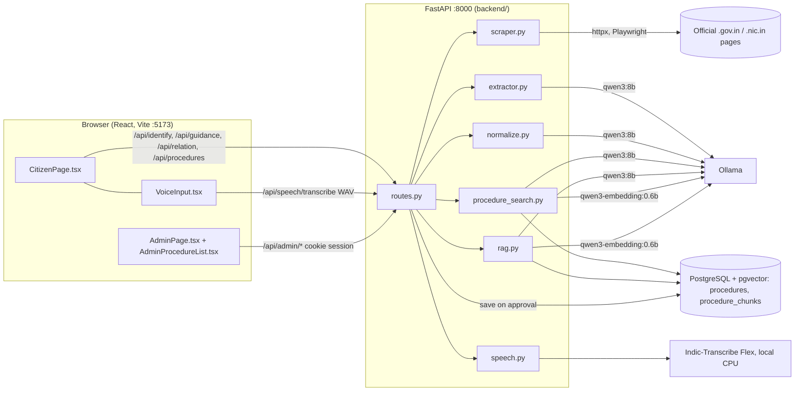

# 00 — START HERE: ProcedureAssist AI

> **Update 28 Oct 2026, 10:45 IST: read `21` and `22` (top sections) for the current state.** Sections 5–7 below show 27 Oct evening and are refreshed in the paused handoff audit.
> - The original execution brief is complete up to the owner-approval boundary.
> - N3, N4 and N8 are approved (approved database 27 pages / 134 chunks; staging 28 / 146). N1 and N10 are deferred.
> - Port 8000 was restarted on the current code (PID 89049).
> - One code fix: `acronym_names`.
> - The production migration still needs the owner.

**Read this first.**
- **Who it is for:** a new Claude account (or a new engineer) taking over with no access to earlier conversations.
- **When and how it was written:** 27 Oct 2026, 18:50–19:30 IST, by inspecting the repository, the databases, the running processes and fresh test runs.
- **Read it with the repository:** where this folder and the repository disagree, the repository wins. Check, then record the difference in `21_AUTONOMOUS_EXECUTION_STATE.md`.
- **The resume prompt** for a new session is in [`15_NEXT_SESSION_PROMPT.md`](15_NEXT_SESSION_PROMPT.md).

Labels used throughout this folder:

| Label | Meaning |
|---|---|
| **VERIFIED** | Checked against code, data or a test run; the evidence is named |
| **IMPLEMENTED** | In the code and covered by unit tests, without a live end-to-end measurement here |
| **PARTIAL** | Partly implemented |
| **PLANNED** | Designed, not implemented |
| **REJECTED** | Tried or designed, then rejected for a measured reason: do not repeat without new evidence |
| **REMOVED** | Was implemented, then removed |
| **DEFERRED** | Postponed by decision |
| **REQUIRES OWNER APPROVAL** | Must not be done without the owner's explicit approval of the exact operation |
| **UNVERIFIED** | Could not be checked; say what would check it |

---

## 1. What ProcedureAssist AI is

**The problem.** Indian government procedures are hard for citizens to find out about, for example:
- renewing a driving licence, or registering to vote;
- updating Aadhaar, linking PAN with Aadhaar, or claiming EPF.

The official information exists, but it is spread over many department websites, and written in administrative English inside tables, accordions and PDFs. General chatbots answer fluently but invent fees, documents and deadlines.

**What the application does:**
- It answers a citizen's question **only from official government pages that a human reviewed and approved**.
- An answer is a list of short claims. Each claim carries a word-for-word quote from the approved page and a link to it, and code checks every quote.
- When the approved pages do not answer, the app says so (**abstention**). When the question could mean several services, it asks (**clarification**).
- Citizens can ask in English, Tamil, Romanized Tamil or a mix, typed or spoken. Answers are always in English.

**Users:**

| User | Page | What they can do |
|---|---|---|
| Citizen | `http://localhost:5173/` | Ask a question. See the matching procedure card (steps, eligibility, official link) and a verified answer, or choose between close matches, or answer a clarification question. Ask follow-ups. Use voice input and read-aloud |
| Admin (reviewer) | `http://localhost:5173/admin` | Sign in (one admin account). Paste an official URL and **Extract** a draft. Review and correct it, then **Approve and save** it. List and delete saved procedures |

**How a procedure becomes knowledge.** A page passes through four states:
1. **Official source:** an HTML page on an allowed official domain (`OFFICIAL_SOURCE_DOMAINS`, default `gov.in`, `nic.in`, `pfrda.org.in`).
2. **Extracted draft:** `POST /api/admin/extract` scrapes the page into plain paragraphs, and `qwen3:8b` drafts a card from them (name, department, jurisdiction, summary, eligibility, steps).
   - **Nothing is saved.**
   - A signed provenance token, valid for 2 hours, binds the URL to the exact scraped text.
3. **Reviewed card:** the admin corrects the draft in the browser. The scraped text cannot be edited.
4. **Approved procedure:** `POST /api/admin/procedures` checks the token, then saves the reviewed card and the exact scraped text. In the same transaction it stores the text's chunks and their 1024-dimension embeddings.
   - **There is no status column.** A row in `procedures` *is* an approved procedure.
   - Only approved procedures are searched and quoted.

**What it deliberately does not do:**
- apply, pay or submit anything;
- read PDFs or pages behind a login;
- answer from the model's general knowledge;
- let the model save or approve a procedure by itself;
- answer in Tamil.

Details: [`01_PROJECT_OVERVIEW.md`](01_PROJECT_OVERVIEW.md).

## 2. Technology (VERIFIED 27 Oct 2026)
| Layer | Technology |
|---|---|
| Backend | Python 3.14.3, FastAPI 0.141.1, Pydantic (with FastAPI), SQLAlchemy 2.0.54, uvicorn 0.53.0 (`requirements.txt`) |
| Database | PostgreSQL 16.14 with pgvector 0.8.0 (Python package `pgvector` 0.5.1) |
| Scraping | httpx 0.28.1 and BeautifulSoup 4.15.0; Playwright 1.63.0 Chromium as a fallback for pages the direct fetch cannot read |
| Models | Ollama, local:<br>• `qwen3:8b` (5.2 GB): extraction, Tamil normalisation, splitting several needs, answers, the meaning check<br>• `qwen3-embedding:0.6b`: 1024-dimension vectors |
| Speech (optional) | Indic-Transcribe Flex (`bodhan-ai/indic-transcribe-flex`), CPU, inside the backend (`requirements-speech.txt`) |
| Frontend | React 19.3, TypeScript 7.0.2, Vite 8.3.1, Vitest 5 with Testing Library; Node 22.23.1 |
| Hosting | One laptop. No containers, proxy, HTTPS or monitoring |

## 3. Architecture at a glance

- **Admin flow:** Extract (scrape, model draft, token) → human review → Approve (token check, chunk, embed, one transaction).
- **Citizen flow:**
  1. `/api/identify`:
     - Tamil is normalised to an English query;
     - a question that names no service is asked which one;
     - lower-case abbreviations are read in capitals;
     - several needs are split out;
     - the vector ranking is followed by the identification rules;
     - the result is matched, a choice, no match or a clarification.
  2. `/api/guidance`: 5 chunks are retrieved, the model drafts claims with quotes, code checks every quote, then a second model reading checks meaning, then the applicant-type rule, then completion from a fee table. The result is verified claims or `insufficient_evidence`.
  3. The page shows a card only when the citizen named or chose the procedure, or when its answer has verified claims.

Details: [`02_SYSTEM_ARCHITECTURE.md`](02_SYSTEM_ARCHITECTURE.md) (components, every module, diagrams) and [`03_AI_AND_RAG_LOGIC.md`](03_AI_AND_RAG_LOGIC.md) (every AI stage and rule).

## 4. Repository map (`/Users/arunnm/Projects/SOP`)
```
backend/              FastAPI application (~2,700 lines)
  main.py             app, CORS, request-id logging, 503 on database outage; creates tables on import
  routes.py           every endpoint: public router + admin_router (require_admin)
  config.py           settings from the environment / .env (document names only; never values)
  database.py         engine, sessions, read-only session for citizen routes
  models.py           tables procedures and procedure_chunks
  schemas.py          Pydantic request and response models, size limits
  auth.py             scrypt password check, signed session cookie (12 h), login limit, provenance token (2 h)
  scraper.py          URL safety, official-domain check, static fetch, browser fallback, clean_html
  extractor.py        Ollama client (ollama_post, call_qwen), extraction prompt, draft validation
  procedure_search.py identification: ranking, abbreviation, residence, name and document rules, several needs
  rag.py              chunking, embeddings, retrieval, answer prompt, claim verification, meaning check, relation and comparison
  normalize.py        Tamil / Romanized Tamil → one English query (or "needs clarification")
  speech.py           optional local speech-to-text (WAV, at most 30 s, nothing stored)
frontend/src/         CitizenPage, AdminPage, AdminLogin, AdminProcedureList, VoiceInput, api.ts, App.tsx (+ *.test.tsx)
tests/                14 files, 252 backend tests (unittest); database tests use procedureassist_test only
scripts/              evaluate_answers.py, evaluate_needs.py, evaluate_identification.py, evaluate_ingestion.py, approve_batch.py
fixtures/evaluation/  labelled evaluation sets (JSON, matched by source-URL fragment); fixtures/ingestion/demo_batch.json
PROCEDUREASSIST_HANDOFF/  this handoff and evidence/ (scripts, outputs, backups' checksums). UNTRACKED in Git
start.sh, run.sh      start PostgreSQL, Ollama, backend (:8000) and frontend (:5173)
README.md, DEMO.md, test_websites_and_questions.txt   user-facing docs (DEMO.md and the .txt are from 17–21 Oct)
.env                  secrets and the database URL: never read, print, edit or commit it. .env.example lists the names
```
Backups are outside the repository: `/Users/arunnm/Projects/SOP-backups/`. There are four custom-format dumps; see `07`.

## 5. Current state (VERIFIED 27 Oct 2026, 18:50–19:30 IST)

### 5.1 Code and Git
- **Branch:** `arun-nm`. **HEAD:** `3491415` "staging" (23 Oct). Main branch: `main`. Remote: `origin`, `github.com/Arun-N-M-07/Societal-Oriented-Project`.
- **Not committed:** everything since 23 Oct, in 43 status entries.
  - **36 modified:**
    - `.env.example`, `README.md`;
    - 9 backend files;
    - 5 fixtures;
    - 8 frontend files;
    - 2 scripts;
    - 10 test files.
  - **7 untracked:**
    - **`PROCEDUREASSIST_HANDOFF/` itself;**
    - five fixtures (`generalisation`, `heldout`, `identification_failures`, `residence_and_documents`, `safety`);
    - `scripts/evaluate_ingestion.py`.
  - Nothing staged, no stash.
  - **This handoff exists only in the working tree.** Do not clean, reset or move it.
- **`.env`:** last modified 15 Oct 2026 08:38:46. Untouched.
- **Application code** (`backend/`, `frontend/src/`): unchanged since the previous brief's final suite (27 Oct 08:20).
  - This session changed only `scripts/evaluate_answers.py`, `scripts/evaluate_needs.py`, 8 fixtures and the handoff folder.
  - Full list in `21`, "Current brief: files changed".

### 5.2 Tests
| Check | Result | When |
|---|---|---|
| Backend `REQUIRE_DB_TESTS=1 .venv/bin/python -m unittest discover -s tests` | **252 OK** | 27 Oct 18:56 (VERIFIED) |
| Frontend `npm test --prefix frontend` | **67 passed** (6 files) | 27 Oct 18:56 (VERIFIED) |
| Type check `frontend/node_modules/.bin/tsc --noEmit` | **OK** | 27 Oct 18:56 (VERIFIED) |
| Production build `npm run build --prefix frontend` | OK | 27 Oct ~09:00 (previous brief; not re-run, it writes `dist/`) |
| Evaluation sets (real models) | Latest full suite: `evidence/evaluations/p7_final/` (27 Oct 08:20–09:12). For example, main 76/80 staging and 75/80 approved; held-out 23 and 24 of 27; safety 47/59 and 40/53; follow-ups 17/17 | **Historical for staging.** Since that run, page 17 was deleted from staging and the fixture labels changed; see `05` |

### 5.3 Databases (PostgreSQL on localhost; checksums from `evidence/database/db_checksums.sql`, 18:52)
| Database | Role | Pages | Chunks | md5 procedures / chunks |
|---|---|---|---|---|
| `procedureassist` | **Approved: what citizens see** (the `.env` database) | 24 | 122 | `016980ee…` / `3e45c78f…`. **Unchanged since 23 Oct** |
| `procedureassist_staging` | Rehearsal of the migration (the reference for `validate_migration.py`) | **25** | **134** | `96697b50…` / `73da35b3…`. **Changed today 10:50: page 17 deleted** |
| `procedureassist_scratch` | Created today 10:47 from a fresh dump of approved, for testing candidates on a production copy | 24 | 122 | Equal to approved |
| `procedureassist_test` | Unit tests (rolled-back transactions) | 0 | 0 | — |
| `procedureassist_db` | Not part of this project (no tables); never touched | — | — | — |

All four project databases: 0 orphan chunks, all embeddings 1024-dimensional, no chunk-index gaps. Full checksums are in `21`.

### 5.4 Running processes
- **Port 8000:**
  - PID 75965: `python -m uvicorn backend.main:app --host 127.0.0.1 --port 8000`. Working directory: the repository. Parent: `launchd`.
  - Started **23 Oct 22:51** by an earlier session, so it serves **code from 23 Oct**. Python does not reload by itself.
  - No open connections. Its log shows its last request on 25 Oct 15:23.
  - **Not restarted.** It is safe to restart; the procedure is in `09`.
- **Other services:** no frontend dev server is running. Ollama (PID 1034) and PostgreSQL are running.
- **Claude sessions in this project:**
  - PID 51627, this session, which ends with the handoff. `caffeinate -dimsu -w 51627` (PID 28149) exits with it.
  - PID 17576: idle since 25 Oct. It wrote docs `13` and `14`; leave both unused and unedited.
  - The other Claude processes on this machine work in a different project ("Optimization Arena"): leave them alone.
- **Run only one Claude session against this working tree.**

### 5.5 Migration and candidates
| Item | Status |
|---|---|
| Revised migration: **delete** page 17; **replace** 18, 19, 20, 27, 35, 36, 37, 38; **move** 16, 31, 32, 33; **add** 39, 40; 11 pages untouched | **Prepared and rehearsed on staging; NOT executed.** REQUIRES OWNER APPROVAL. Checklist: `19`, "Final migration approval checklist" (revised 27 Oct) |
| Page 17 deletion | Tested on the scratch copy (rolled back) and done on staging. Production: REQUIRES OWNER APPROVAL |
| N1 Instant e-PAN, N3 Police Clearance Certificate, N4 Aadhaar Enrolment, N8 Registration of Births and Deaths | **Sources verified, cards corrected (DONE). Retrieval tests and approval NOT STARTED.** Approval is delegated to Claude; no per-candidate owner approval |
| N10 New Ration Card | **DEFERRED:** the page's submission route dates from 2008 |
| N2, N5, N6, N7, N9, N11 | **DEFERRED by the owner:** do not add |

### 5.6 What happened in the interrupted session (details: `21`)
1. **Reconnaissance** (10:38–10:55).
2. **Backups** of staging and approved (10:46). A **scratch copy** of approved was restored and checked (10:47).
3. **Page 17:**
   - deletion tested on the scratch copy through the real DELETE route, rolled back (10:49);
   - then deleted from **staging** (10:50), giving 25 pages and 134 chunks, as the revised plan predicts.
4. **The five candidate pages** were re-extracted through the admin route (10:50).
   - All five texts are unchanged since 26 Oct.
   - N1, N3, N4 and N8 were reviewed line by line and their cards corrected. N10 was deferred.
5. **The evaluation scripts and fixtures were made unambiguous** for the new pages ("psp/Apply" ≠ "psp/ApplyPCC"; Aadhaar update ≠ enrolment) (~11:00–11:25).
6. **The work stopped around 11:30**, before any candidate test or approval. A documentation-only handoff followed (18:50–19:30). It changed no code and no database.

## 6. The most important known issues
1. **Page 17 on the approved database misleads.** Asked about birth, death, community or income certificates, it answers with CAN-editing steps, and two of its document lists mix certificates. **Fixed only by the production deletion (REQUIRES OWNER APPROVAL).** Measured: `evidence/investigations/p7_migration/page17_questions_approved.txt`.
2. **The approved database still holds 9 pages whose stored text lost meaningful content** at scraping time (FAQ questions, eligibility cards, fee-table rows). The migration fixes it (REQUIRES OWNER APPROVAL). Background: `06`, `07`.
3. **Evaluation labels are not yet adapted to the deleted page 17.** Until `10`, P1 is done, staging runs report about 15 page-17 cases as failures, and those failures are not real.
4. **Port 8000 runs 23 Oct code.** Restart it before any live check (`09`).
5. **Identification limits** (measured; `20`, `22`):
   - the 4 colloquial RC/DL misses;
   - 2 of 8 overseas phrasings get no answer, because the model drafts no claim;
   - cities the code cannot place lead to a choice;
   - "Lok Sabha" (on no page) blocks a match.
6. **P1-3:** a chunk of page 19 starts mid-sentence ("fill form 7 … Please fill Form 8 …"). The held-out electoral-roll correction then reaches the right page but abstains. The behaviour is safe, and the fix is a future, separately evaluated change.
7. **The 8B model often quotes inexactly.** Verification then rejects the claim, which is safe but loses answers.
8. **The backend cannot start without the database** (`create_all` on import). During operation, a database outage gives a 503 with a message.
9. **Not production-hardened:**
   - local only;
   - signed cookies cannot be revoked;
   - DNS rebinding is not closed for a rendered page's sub-resources;
   - no HTTPS, monitoring or scheduled backups.
10. **Never verified:** Tamil voice input with real Tamil speech (no Tamil voice on this Mac), and a manual browser walkthrough (the last walkthrough was automated with Playwright).
11. **Pre-approval risks found in code review (candidate checks):**
    - the single letter "e" of "e-PAN" in `acronym_names`;
    - "Aadhaar Enrolment" inside page 35's name, in `named_by_the_others`.

    Test both before approving N1 and N4 (`evidence/investigations/p9_final/candidate_review_27oct.md`).

## 7. What to do next (summary; full roadmap with files and checks: [`10_PENDING_WORK.md`](10_PENDING_WORK.md))
| Priority | Work | Owner approval |
|---|---|---|
| **P1 Immediate** | Adapt the evaluation labels to the changed collection: page 17 `requires`/`unless`; the cases the candidates now answer; the §7 card-safety cases. Then a baseline run on staging | No |
| **P2 Candidates** | Test N1, N3, N4 and N8 on the scratch copy. Then approve them into staging, then into production, through the admin routes; verify records, chunks and embeddings; record outcomes | **No (delegated)** |
| **P3 Reliability** | The §7 card-safety list. The P1-3 write-up. Restart port 8000 and run one live check. Re-run the full suites | No |
| **P4 Migration preparation** | Field review of the 8 replacements and ID 33's assessment-year freshness. Update `validate_migration.py` and `migration_packets.py` for the deletion, the candidates and page 39's step. Regenerate the packets | No (preparation only) |
| **P5 Owner approval** | Run the production migration: page 17 deletion, replacements, moves, additions. Fresh backup and restore check first. Maintenance window and traffic pause | **YES** |
| **P6 Future** | Sentence-aware chunking (with its own staging evaluation); PDFs; Tamil answers; deployment hardening | Owner decides scope |

## 8. Permissions and restrictions (the owner's standing rules)

**8.1 Claude may do these without asking:**
- read the code and documents (never `.env`);
- run the tests and the read-only evaluations (one Ollama workload at a time);
- run read-only database queries;
- use `procedureassist_test` (rolled back) and `procedureassist_scratch`;
- write documentation and evidence.

**8.2 Delegated by the owner (brief of 27 Oct, §5):** review, correct, test and **approve N1, N3, N4, N8 and N10** through the existing admin workflow.
- This includes approving them into the approved database.
- Do **not** ask the owner for each candidate.
- Approve only when every check in §5.4 of that brief passes; otherwise record why and defer.
- The delegation does **not** cover any other candidate, or any destructive or migration operation.

**8.3 Requires the owner's explicit approval:**
- deleting page 17 from the approved database;
- replacing approved procedures;
- moving approved URLs;
- adding any other procedure there, including pages 39 and 40;
- any destructive production operation;
- restoring or rolling back a database;
- the maintenance window and the traffic pause;
- commits and pushes;
- any `.env` or environment change.

**8.4 Never:**
- **Data and the database:**
  - print or write secrets, or write the database URL into a file. Derive it at run time (see `09`);
  - drop or recreate `procedureassist` or `procedureassist_staging`;
  - delete unrelated records, or re-embed unrelated pages;
  - bypass human review and approval, or let model output be saved without review.
- **Features and design:**
  - reintroduce the removed **Re-extract** feature (`POST /api/admin/re-extract`, removed 26 Oct);
  - lower the identification thresholds (0.53 / 0.03) without new evidence;
  - add an LLM identification layer without strong experimental evidence;
  - write page-specific rules or hard-coded question-to-procedure mappings;
  - force a match where a clarification or an abstention is safer.
- **Evaluations:**
  - change evaluation expectations to raise a score. Labels change only when the collection changes, are decided before the run, and are recorded with the reason.
- **Process:**
  - run two Claude sessions on this working tree;
  - edit `13_*.md` or `14_*.md`, which belong to another session;
  - use destructive Git commands (`reset`, `clean`, `checkout --`, stash-and-drop).

**8.5 How the owner wants the work done.** Background: the owner is Arun N M (Arun-N-M-07), an IT undergraduate. Explain in plain language, make minimal tested changes, and get approval before changing data or Git.
- **Do not overengineer.** Fix an existing function before adding one. No helper used once, no new module, service, dependency or layer without a demonstrated need. Do not increase lines of code without a reason.
- Test every meaningful change, with positive and negative cases. Use mutation checks where cheap.
- Find the root cause at the right pipeline stage (source, scraping, chunking, retrieval, generation, verification), with evidence, before fixing anything.
- Report clarifications, abstentions, missed answers and misleading answers separately. Never claim universal accuracy.
- Keep `21_AUTONOMOUS_EXECUTION_STATE.md` current after every milestone.

## 9. How to resume safely
1. Read this file. Then read `21` (current state and what not to repeat) and `10` (what to do).
2. Check that nothing changed since this handoff:
   ```bash
   cd /Users/arunnm/Projects/SOP && git status --short | wc -l && git log --oneline -1 && stat -f "%Sm" .env
   for db in procedureassist procedureassist_staging procedureassist_scratch; do echo $db; psql -At -d $db -f PROCEDUREASSIST_HANDOFF/evidence/database/db_checksums.sql | head -4; done
   lsof -nP -iTCP:8000 -sTCP:LISTEN; ps -axo pid,lstart,command | grep -i "[c]laude" | cut -c1-120
   ```
   Expect:
   - 43 status entries, HEAD `3491415`, `.env` from 15 Oct;
   - the checksums in 5.3;
   - PID 75965 on port 8000.

   If the approved checksums differ, someone changed approved data: find out before doing anything else.
3. Run the tests (`09`). Expect 252 backend, 67 frontend and a clean type check.
4. Compare this handoff with the code where you are about to work. Write every difference into `21`.
5. Continue with the first incomplete item in `10` (P1), keep `21` current, and stop at the approval boundary (8.3).

## 10. Reading order
| # | Document | Read it for |
|---|---|---|
| 1 | `00_START_HERE.md` | This overview |
| 2 | [`21_AUTONOMOUS_EXECUTION_STATE.md`](21_AUTONOMOUS_EXECUTION_STATE.md) | The exact state, operations performed, what not to repeat (newest brief at the top) |
| 3 | [`10_PENDING_WORK.md`](10_PENDING_WORK.md) | The prioritised roadmap |
| 4 | [`01_PROJECT_OVERVIEW.md`](01_PROJECT_OVERVIEW.md) | Product, users, scope, requirements, evolution |
| 5 | [`02_SYSTEM_ARCHITECTURE.md`](02_SYSTEM_ARCHITECTURE.md) | Architecture, every module (codebase guide), diagrams, error handling |
| 6 | [`03_AI_AND_RAG_LOGIC.md`](03_AI_AND_RAG_LOGIC.md) | Every AI stage and verification rule, in detail |
| 7 | [`07_DATABASE_AND_SAFETY.md`](07_DATABASE_AND_SAFETY.md) | Databases, staging history, backups and restores, the migration's data side |
| 8 | [`19_MASTER_RELIABILITY_EXECUTION.md`](19_MASTER_RELIABILITY_EXECUTION.md), section "Final migration approval checklist" | **The migration checklist** (revised 27 Oct for the page 17 deletion) |
| 9 | [`11_DECISION_LOG.md`](11_DECISION_LOG.md) | Why things are as they are; **rejected approaches: do not repeat** |
| 10 | [`05_EVALUATION_RESULTS.md`](05_EVALUATION_RESULTS.md) | Evaluation sets, metric meanings, results (current state at the top) |
| 11 | [`09_SETUP_AND_RUNBOOK.md`](09_SETUP_AND_RUNBOOK.md) | Setup, running, tests, evaluations, the admin-route tool, restarting port 8000 |
| 12 | [`08_DEVELOPMENT_HISTORY.md`](08_DEVELOPMENT_HISTORY.md) | Implementation history from Git and the uncommitted work |
| 13 | `evidence/investigations/p9_final/candidate_review_27oct.md` | The candidate reviews and how to finish the approvals |
| 14 | [`22_AUTONOMOUS_FINAL_REPORT.md`](22_AUTONOMOUS_FINAL_REPORT.md), [`20_GENERALISATION_AND_SIMPLIFICATION.md`](20_GENERALISATION_AND_SIMPLIFICATION.md) | The 26–27 Oct briefs' results (identification rules, measurements) |
| 15 | `04_AUDIT_HISTORY.md`, `06_SOURCE_URL_AUDIT.md`, `12_RAG_RELIABILITY_AUDIT.md`, `15_RAG_REGRESSION_TEST_PLAN.md`, `16_W11_IDENTIFICATION_THRESHOLD_INVESTIGATION.md`, `18_COMPLETE_SYSTEM_RELIABILITY_AUDIT.md` | Earlier audits (23–25 Oct): background and evidence |
| — | `13_REPOSITORY_CODEBASE_OVERVIEW.md`, `14_APPLICATION_ARCHITECTURE_AND_EXECUTION_FLOW.md` | Written on 25 Oct by **another session**; not edited since. Useful but **outdated in places**: they still describe `POST /api/admin/re-extract` (removed 26 Oct) and predate the 26–27 Oct identification rules and the 503 handler. Prefer `02`, `03` and the code |
| — | [`15_NEXT_SESSION_PROMPT.md`](15_NEXT_SESSION_PROMPT.md) | The prompt to start the next session. Note that two files are numbered 15 |

`README.md` (setup, limitations) is current. `DEMO.md` and `test_websites_and_questions.txt` describe the 17–21 Oct demo batch and are historical. There is no `docs/` folder.

## 11. Not verified, or not recoverable
- **Not in the repository:** the original requirements text and early design documents. `01` reconstructs them from the README, the code and Git history.
- **Never tested:**
  - Tamil voice with real Tamil speech (only a synthetic English voice was transcribed live);
  - a manual browser walkthrough;
  - the `vite build` output since 27 Oct 09:00 (not re-run).
- **N8's currency:** the page is undated (UNVERIFIED).
- **N10's current official route:** it could not be read from an official page (UNVERIFIED).
- **Why the scraper rejects `https://www.tnpds.gov.in/`** ("not an official website", presumably after a redirect): UNVERIFIED.
- **Evaluation snapshots lost:** the snapshots used for the 25–27 Oct evaluations (`snap_*`) were in that session's temporary scratchpad and will not survive it. Each evaluation folder's `frozen_inputs.txt` keeps the SHA-256 of every input file, so results stay traceable. Make new snapshots with `evidence/other/scripts/make_snapshot.sh`.
