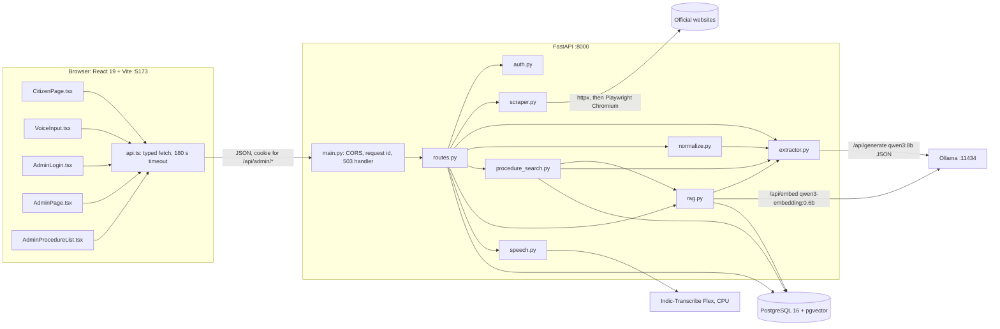
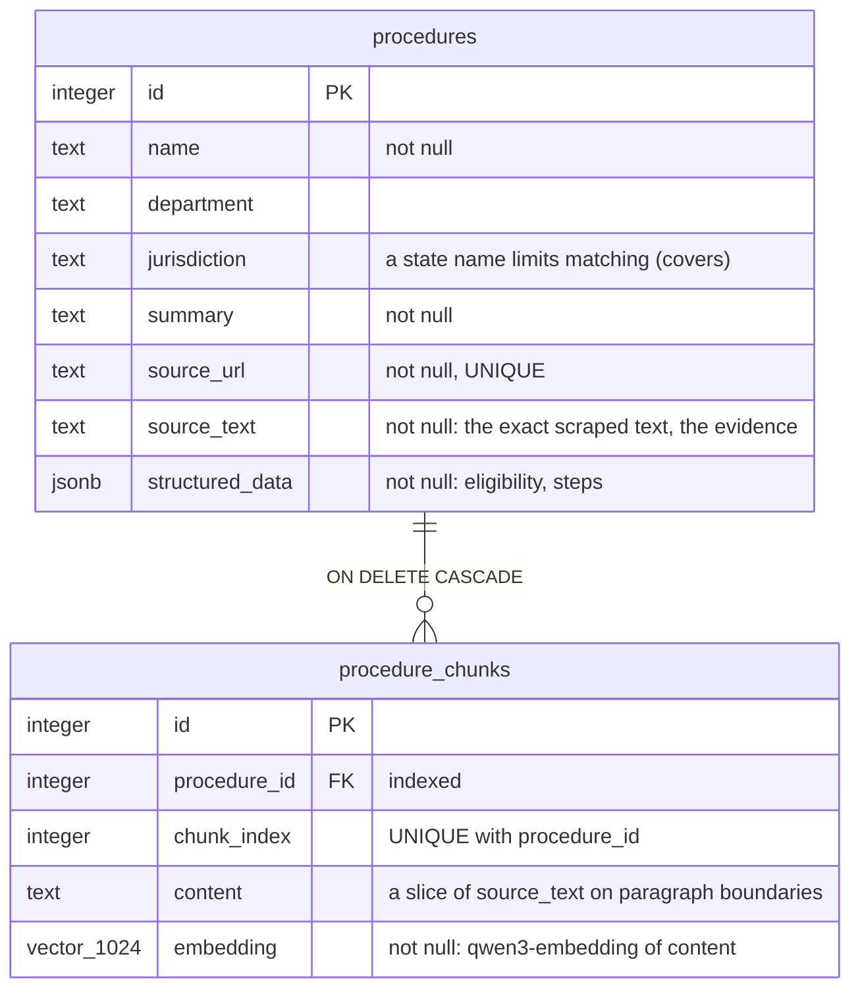
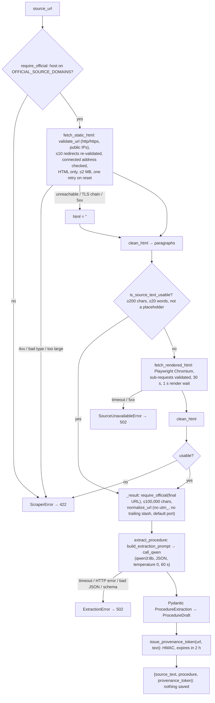
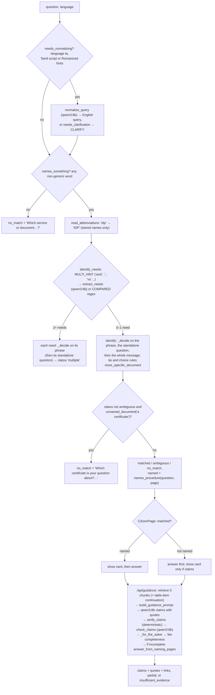

# 02 — System architecture and codebase guide

**Verified against the code on 27 Oct 2026, evening.** The working tree is the uncommitted state on top of `3491415`.
- Line counts are approximate.
- The AI stages are explained rule by rule in `03_AI_AND_RAG_LOGIC.md`; this file explains the structure and how the files work together.
- Docs `13` and `14` (another session, 25 Oct) describe an older state, for example the removed `/api/admin/re-extract`.

## 1. Shape of the system
- **Deployment:** one machine. `./start.sh` starts:
  - PostgreSQL (Homebrew service);
  - Ollama (`ollama serve`; it checks that both models are installed and warms `qwen3:8b`);
  - then `run.sh`, which installs Python and npm dependencies and Playwright Chromium, checks the database connection, then runs the backend (`uvicorn backend.main:app --host 127.0.0.1 --port 8000`) and the frontend (`vite --host 127.0.0.1 --port 5173 --strictPort`).

  There is no container, reverse proxy or production deployment.
- **Browser:** the browser talks to the backend only.
  - The backend talks to PostgreSQL, Ollama and the official websites. Optionally it also runs the speech model in-process.
  - Use `http://localhost:5173`, not `127.0.0.1`: CORS allows only `FRONTEND_ORIGIN`.



## 2. Endpoints (`backend/routes.py`)
| Method and path | Access | Database session | What it does |
|---|---|---|---|
| `GET /health` | public | — | Liveness: `{"status": "ok"}` |
| `GET /health/ready` | public | read | Checks `procedure_chunks` is readable and that both models are installed in Ollama. 503 when not |
| `POST /api/admin/login` | public | — | Username and password against the scrypt hash. Sets the `admin_session` cookie (httponly, SameSite=strict, 12 h). 429 after 5 failures from one address in 15 min |
| `POST /api/admin/logout`, `GET /api/admin/session` | public / admin | — | Clear the cookie; report the signed-in user (401 if none) |
| `POST /api/admin/extract` | **admin** | — | `scrape_url` → `extract_procedure`. Returns `{source_text, procedure (draft), provenance_token}`. **Saves nothing.** 422 for a bad or unusable page; 502 if the site or the model is unavailable |
| `POST /api/admin/procedures` | **admin** | write | Approval: verify the token (422 if the text or URL changed or it expired); `build_chunks` (chunk + embed; 502 if embedding fails, nothing saved); insert procedure + chunks, then commit. 409 if the URL exists |
| `GET /api/admin/procedures` | **admin** | write session, used read-only | List (id, name, department, jurisdiction, URL), newest first |
| `DELETE /api/admin/procedures/{id}` | **admin** | write | Delete; its chunks go by cascade. 404 if missing |
| `GET /api/procedures`, `GET /api/procedures/{id}` | public | **read-only** | Summaries by name; one card (eligibility, steps, URL) |
| `POST /api/identify` | public | **read-only** | Question (≤1,000 characters; `language` `en` or `ta`). Returns:<br>• `matched`, `ambiguous`, `no_match` or `multiple`;<br>• optional `clarification`, `normalized_query`, `named`, `needs`, `pending`, `relation_question`.<br>502 if embeddings fail |
| `POST /api/guidance` | public | **read-only** | `{procedure_id, question, language}` → verified `claims` (text, `chunk_id`, quote, optional `procedure_id`/`source_url` from a related page), `omitted_claims`, `partial`, `insufficient_evidence`. 502 if the model is unavailable |
| `POST /api/relation` | public | **read-only** | 2–10 procedure ids + question → relation claims (order, dependency, reuse), or a comparison when the question says "difference / compare / vs" |
| `POST /api/speech/transcribe?language=ta\|en` | public | — | WAV body (≤30 s) → `{text}`. Errors:<br>• 415 not WAV; 413 too long; 422 unusable audio;<br>• 503 not installed or busy; 502 failed; 504 after 120 s |

- All admin routes are on `admin_router`, which depends on `require_admin` (`test_auth.py` asserts every admin route needs a session).
- All citizen routes use `get_read_only_db`, so PostgreSQL itself refuses writes.

## 3. Database (verified with `\d`, 27 Oct)

- **No other tables, and no approval-status column.** The tables are created by `Base.metadata.create_all` when `backend.main` is imported; there is no migration framework.
- **Nothing else stores procedure ids.** The evaluation fixtures match pages by URL fragment. So deleting a procedure cannot leave dangling references.
- **Similarity search** is SQL: `1 - embedding.cosine_distance(vector)` in `rank_procedures` and `retrieve`. There is no vector index; the tables are small (122–140 chunks).
- **Databases on this machine:** see `07` and `00` §5.3.

## 4. Request lifecycles

### 4.1 Ingestion: `POST /api/admin/extract`


### 4.2 Review and approval: `POST /api/admin/procedures`
```mermaid
sequenceDiagram
  participant Admin as Admin (AdminPage.tsx)
  participant API as routes.save_procedure
  participant RAG as rag.build_chunks
  participant OL as Ollama embeddings
  participant DB as PostgreSQL
  Admin->>Admin: edit name, department, jurisdiction, summary, eligibility, steps (reorder, add, remove)
  Admin->>API: {procedure: reviewed card + source_url, source_text, provenance_token}
  API->>API: verify_provenance_token (same URL + text, signed, not expired), else 422
  API->>RAG: chunk_text(source_text): ~1,000 chars, paragraph boundaries, heading-aware
  RAG->>OL: /api/embed all chunks (one retry on transient errors)
  OL-->>RAG: 1024-d vectors (else EmbeddingError → 502, nothing saved)
  API->>DB: INSERT procedure; flush; INSERT chunks; COMMIT
  DB-->>API: unique violation → rollback → 409
  API-->>Admin: {id, name, status: "saved"}
```
- **The review is human.** The draft is only a starting point; the admin page sends whatever the reviewer left in the form.
- **The scraped text cannot be changed.** The token binds it.
- **Embeddings are made before the transaction** (`build_chunks` is called outside it), so a slow model never holds a database lock.

### 4.3 Citizen question: `POST /api/identify`, then `/api/guidance`

- **`_decide` steps, one text at a time:**
  1. `rank_procedures`: the top 3 pages by best-chunk cosine.
  2. `classify`: matched if exactly one page scores ≥ 0.53 and is within 0.03 of the best; several → ambiguous; none → no match.
  3. The abbreviation override: an acronym naming exactly one nearby page (≥ 0.45). Otherwise, on a near miss, a term only one page uses ("VVPAT").
  4. Residence: choose between a service and its overseas sibling.
  5. `mentions` (names in the question must appear on the page) and `covers` (state jurisdiction).
  6. The acronym-home filter: "PAN" names the PAN page, not every page that uses a PAN.
  7. `named_by_the_others` in a close call.

  Each rule, with its reason and measurements: `03` §2.2.
- **Several needs:** the page answers each matched need separately, then asks `/api/relation` for the relation question.

### 4.4 Follow-ups and the card rule (`frontend/src/CitizenPage.tsx`)
- **No procedure open:** `handleResult`.
  - **matched:** `showAndAnswer(id, message, named)`. A named procedure's card is shown at once. An unnamed one is shown only if `/api/guidance` returns claims; otherwise the note `NO_ANSWER` appears ("No approved official information answers this question yet…").
  - **ambiguous:** the candidates are listed and the citizen picks one (`openProcedure`, counted as named).
  - **no_match:** `NO_MATCH`, or the server's clarification text.
- **A procedure open:** `answerFollowUp`.
  1. Identify the follow-up first.
  2. If it names another procedure (`named`), that procedure answers.
  3. Otherwise the open procedure answers.
  4. If the open procedure cannot, a different matched procedure is tried, and the page moves to it only if it answers. Otherwise the open page and its reply stay.
- **Several procedures on screen** (multi-need), in `followUp`:
  - a follow-up matching one of them answers from it;
  - a relation question (`ASKS_RELATION`) goes to `/api/relation`;
  - anything else gets "Which procedure is this about?".

## 5. Codebase guide: backend (`backend/`, ~2,700 lines)
| Module | Responsibility | Key names | Called by → calls | Change it when |
|---|---|---|---|---|
| `main.py` (70) | Builds the app, as described below the table | `app`, `log_request`, `database_unavailable`, `REQUEST_ID` | uvicorn, tests, scripts (`TestClient(app)`) → `routes.router`, `database` | Adding middleware or error handlers. The startup dependency on the database is here (`create_all`) |
| `config.py` (51) | Settings from the environment, then `.env` (python-dotenv; the environment wins), as described below the table | constants | everything | Adding a setting (also add it to `.env.example` and `09`) |
| `database.py` (26) | Engine, `SessionLocal`, `Base`; `get_db` (one session per request); `get_read_only_db` (`SET TRANSACTION READ ONLY`) | — | `routes`, scripts, tests (overridden) | Pool or session policy (see `10`, concurrency) |
| `models.py` (37) | `Procedure`, `ProcedureChunk` (`Vector(EMBEDDING_DIMENSIONS)`, cascade, unique index pair) | — | `routes`, `rag`, `procedure_search`, scripts | Schema changes (no migration tool: needs a plan and the owner's approval) |
| `schemas.py` (230) | Strict Pydantic models (`extra="forbid"`) with the limits listed below the table | `ProcedureExtraction`, `ProcedureDraft`, `ApprovalRequest`, `IdentifyResponse`, `GuidanceResponse`, `RelationResponse` | `routes`, `extractor`, `scraper` | API shape changes (mirror them in `frontend/src/api.ts`) |
| `auth.py` (132) | Admin security, as described below the table | `require_admin`, `issue_provenance_token`, `verify_provenance_token`, `login_blocked` | `routes` | Session or token policy |
| `scraper.py` (407) | Official-domain check, URL safety, static fetch, browser fallback, `clean_html` (page → paragraphs) | `scrape_url`, `validate_url`, `require_official`, `clean_html`, `_is_block`, `_row_context`, `is_menu`, `normalize_url` | `routes.create_extraction`, `scripts/evaluate_identification.py`, evidence scripts → httpx, BeautifulSoup, Playwright | Pages losing text. **A change can alter future scrapes of every page**: compare with `evidence/other/scripts/rescrape_dry.py` before and after |
| `extractor.py` (125) | Ollama client and the extraction step, as described below the table | `ollama_post`, `call_qwen`, `build_extraction_prompt`, `extract_procedure` | `routes`, `normalize`, `procedure_search`, `rag` | Model parameters, the extraction prompt |
| `normalize.py` (70) | Tamil, Romanized Tamil or mixed text → one English query. A failure falls back to the original question | `needs_normalizing`, `normalize_query`, `PROMPT`, `ROMANIZED_TAMIL` | `routes._normalized` → `call_qwen` | Tamil handling (measure with `fixtures/evaluation/tamil.json`) |
| `procedure_search.py` (443) | Identification (§4.3; rules in `03` §2.2) | `identify`, `identify_needs`, `_decide`, `classify`, `rank_procedures`, `mentions`, `covers`, `acronym_names`, `names_procedure`, `residence`, `read_abbreviations`, `unnamed_document`, `more_specific_document`, `named_by_the_others` | `routes.identify_procedure`, scripts → `rag.embed_texts`, `rag._document_kinds`, `rag.uses_name`, `call_qwen`, the database | An identification failure. Fix the general rule in `_decide` or `identify`, never a page-specific mapping. Measure on every labelled question (`20`) |
| `rag.py` (583) | Chunking, embeddings, retrieval, answering and verification, as described below the table | `chunk_text`, `embed_texts`, `build_chunks`, `retrieve`, `build_guidance_prompt`, `verify_claims`, `check_claims`, `_for_the_asker`, `_checked_answer`, `answer_question`, `answer_from_naming_pages`, `relate`, `compare` | `routes`, `procedure_search`, scripts → Ollama, the database | Wrong or missed answers: add a deterministic rule with positive and negative tests (`tests/test_guidance.py`). **Changing `chunk_text` or `_is_heading` stales stored chunks:** pages must be re-approved. Do not combine that with the migration |
| `speech.py` (110) | Optional voice input, as described below the table | `check_audio`, `transcribe`, `_load` | `routes.transcribe_speech` | Voice behaviour |

**Notes on the busier modules:**
- **`main.py`:**
  - `Base.metadata.create_all` runs **on import**, so the server cannot start without the database;
  - the `procedureassist` logger writes one line per request (12-character request id, also sent as `X-Request-ID`) and never logs question or source text;
  - CORS allows only `FRONTEND_ORIGIN`, with credentials, for GET, POST and DELETE;
  - SQLAlchemy `OperationalError` becomes a 503 "The procedure database is unavailable. Try again."
- **`config.py`:**
  - required: `DATABASE_URL`, `SECRET_KEY` (at least 32 characters) and `ADMIN_PASSWORD_HASH` (must start `scrypt$`);
  - tunables: models, `LLM_CONTEXT_TOKENS` 32768, `EMBEDDING_DIMENSIONS` 1024, `FRONTEND_ORIGIN`, `COOKIE_SECURE`, `OFFICIAL_SOURCE_DOMAINS`, `IDENTIFY_MIN_SCORE` 0.53, `IDENTIFY_MARGIN` 0.03, `MAX_NEEDS` 3, `SPEECH_MODEL(_DIR)`.
- **`schemas.py` limits:** URL ≤2,048; source ≤100,000; ≤100 steps of ≤2,000; question ≤1,000; name ≤300; summary ≤5,000; eligibility ≤10,000; at least one non-empty step.
- **`auth.py`:**
  - scrypt password hash (`python -m backend.auth` prints one); username and password compared in constant time;
  - session token `session:<expiry>:<user>:<HMAC>`;
  - in-memory login limiter (5 failures per 15 min per address);
  - provenance token `provenance:<expiry>:<SHA-256(url\ntext)>:<HMAC>`, valid 2 h;
  - every HMAC uses `SECRET_KEY`.
- **`extractor.py`:**
  - `ollama_post` logs every call and retries once for a dropped connection, a 5xx or a listed status; never after a timeout;
  - `call_qwen` sends `/api/generate` with format json, think false, temperature 0, `num_ctx`, 60 s;
  - the extraction prompt treats the source as untrusted data;
  - errors become `ExtractionError`.
- **`rag.py`:**
  - chunks: 1,000 characters, 200 overlap rule, heading-aware;
  - embeddings: the query gets an instruction prefix, documents do not;
  - retrieval: 5 chunks, plus fee-table item continuation;
  - the answer prompt;
  - **deterministic claim verification**, then the model's meaning check, then the applicant-type rule;
  - fee completeness, completion from a page naming the procedure, relation and comparison;
  - `python -m backend.rag backfill` indexes pages that have no chunks.
- **`speech.py`:** Indic-Transcribe Flex from the Hugging Face cache or `SPEECH_MODEL_DIR` (never downloads). Only 16 kHz mono 16-bit WAV of 0.3–30 s, not silent. One transcription at a time (busy after 30 s waiting). The temporary file is deleted; the transcript is capped at 1,000 characters.

**Errors map to HTTP codes in one place, `routes.py`:**

| Error | Code |
|---|---|
| `ScraperError` | 422 |
| `SourceUnavailableError` | 502 |
| `ExtractionError` | 502 |
| `ProvenanceError` | 422 |
| `EmbeddingError` | 502 |
| `GuidanceError` | 502 |
| `IntegrityError` 23505 (duplicate URL) | 409 |
| other `SQLAlchemyError` on save or delete | 500 |
| `OperationalError` (database unreachable, `main.py`) | 503 |

## 6. Codebase guide: frontend (`frontend/src/`, ~1,500 lines + `styles.css`)
- **No state library and no router library.** Component state lives in `useState`/`useRef`. `App.tsx` checks `window.location.pathname.startsWith("/admin")`.

| File | Responsibility |
|---|---|
| `main.tsx`, `App.tsx` | Mount; route `/admin*` to `AdminApp`, else `CitizenPage`. `AdminApp` checks `GET /api/admin/session`. It shows `AdminLogin` when signed out, handles session expiry (`UNAUTHORIZED_EVENT`), and renders `AdminPage` + `AdminProcedureList` |
| `api.ts` | Typed wrappers for every endpoint, as described below the table |
| `CitizenPage.tsx` (565) | The citizen chat, as described below the table |
| `VoiceInput.tsx` (136) | Records up to 30 s with `MediaRecorder`. `toWav` decodes and resamples to 16 kHz mono 16-bit WAV in the browser, then posts it to `/api/speech/transcribe`. The transcript goes into the question box; nothing is sent until the citizen presses Send. Microphone errors are explained |
| `AdminLogin.tsx` | The sign-in form |
| `AdminPage.tsx` (413) | URL → Extract → the editable review form (text fields; steps with edit, add, remove and drag or keyboard reordering) beside the scraped text, read-only → **Approve and save** (`approveProcedure` with the token) or Discard. Re-extract was removed on 26 Oct |
| `AdminProcedureList.tsx` | List saved procedures; Delete with a confirmation ("Citizens will no longer see it") |
| `*.test.tsx`, `api.test.ts` | Vitest + Testing Library: 67 tests in 6 files (CitizenPage 34, AdminPage 10, VoiceInput 8, App 7, AdminProcedureList 4, api 4) |

**Notes on the larger files:**
- **`api.ts`:**
  - credentials included;
  - 180 s timeout, with the message "The server took too long…";
  - an unreachable server gives the `UNREACHABLE` message;
  - a 401 on an admin call fires `UNAUTHORIZED_EVENT`;
  - error `detail` strings are passed through;
  - the base URL is `VITE_API_BASE_URL`, default `http://localhost:8000`.
- **`CitizenPage.tsx`, the citizen chat:**
  - the language selector (English or Tamil), example questions and voice input;
  - "Searched as" for normalised questions;
  - `handleResult`, `showAndAnswer` (the card rule), `answerFollowUp`, `answerNeeds` / `answerSection` (several needs), `relate`, `followUp`;
  - claims rendered with an "Official source" quote and link;
  - partial and omitted-claim notes;
  - read-aloud with local voices only;
  - errors with a retry button.

## 7. Scripts and tests (how they connect)
- **`scripts/` (read-only against the database named by `DATABASE_URL`; they use the real models, one at a time):**

  | Script | What it does |
  |---|---|
  | `evaluate_answers.py [fixture] [--claims]` | Runs each labelled question through the real API (`TestClient(app)`), modelling the citizen page (follow-ups, the card rule). Reports outcomes, failure stages and identification counts separately |
  | `evaluate_needs.py [fixture]` | Single flow vs multi-need identification |
  | `evaluate_identification.py` | Re-scrapes the labelled pages and checks the thresholds; writes nothing |
  | `evaluate_ingestion.py` | 6 unseen official URLs through Extract → approve → identify → answer, in one rolled-back transaction on `procedureassist_test` |
  | `approve_batch.py <batch.json>` | A **human** batch reviewer: logs in with the typed password, shows each draft and saves only on "y" |

- **`tests/` (252 tests, `unittest`):**
  - `db_support.py` points `DATABASE_URL` at `procedureassist_test` (it refuses any name not ending `_test`), points Ollama at a closed port and sets test-only secrets;
  - `make_client` overrides the session dependencies with rolled-back transactions;
  - tests never call Ollama: embeddings and the model are mocked.
  - Files and counts:

    | File | Tests | Covers |
    |---|---|---|
    | `test_identify.py` | 64 | identification |
    | `test_guidance.py` | 56 | answers and verification rules |
    | `test_scraper.py` | 34 | scraping |
    | `test_rag.py` | 20 | chunking, embedding, retrieval |
    | `test_auth.py` | 13 | |
    | `test_speech.py` | 12 | |
    | `test_normalize.py` | 11 | |
    | `test_extractor.py` | 9 | |
    | `test_save.py` | 7 | |
    | `test_procedures.py` | 7 | |
    | `test_config.py` | 6 | |
    | `test_health.py` | 6 | |
    | `test_routes.py` | 6 | |
    | `test_end_to_end.py` | 1 | |

- **Evidence tooling** (`PROCEDUREASSIST_HANDOFF/evidence/other/scripts/`, `evidence/investigations/p9_final/`):
  - the suite runner, snapshots, the migration validator, the dry-run re-scrape;
  - `admin_workflow.py`, which runs the admin routes in-process for delegated or rehearsal work.

  How to use them: `09`.

## 8. Error handling summary
| Failure | Behaviour |
|---|---|
| PostgreSQL down while running | Any database call: 503 "The procedure database is unavailable. Try again." with `X-Request-ID` (verified live 27 Oct). `/health/ready` reports `database: unavailable` |
| PostgreSQL down at start-up | The backend does not start (`create_all` on import). Known limitation |
| Ollama down / model missing | Readiness 503 ("unavailable" or "models missing"); extract, identify and guidance give 502 with a message (verified live 27 Oct) |
| Malformed model output | Extraction 502; guidance 502 (`GuidanceError`); normalisation and needs extraction fall back silently (the original question is searched) |
| Scraping failure | 422 for client problems (blocked, empty, too large, wrong type, private address, not official); 502 for upstream problems (timeouts, 5xx) |
| Invalid citation | The claim is dropped; with none left, `insufficient_evidence` |
| Invalid input | 422 (Pydantic) |
| Frontend | Errors show their message and a retry button; requests time out after 180 s |
