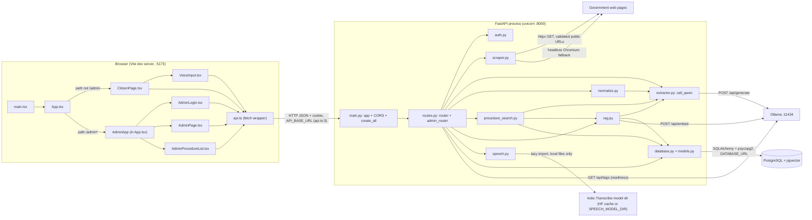
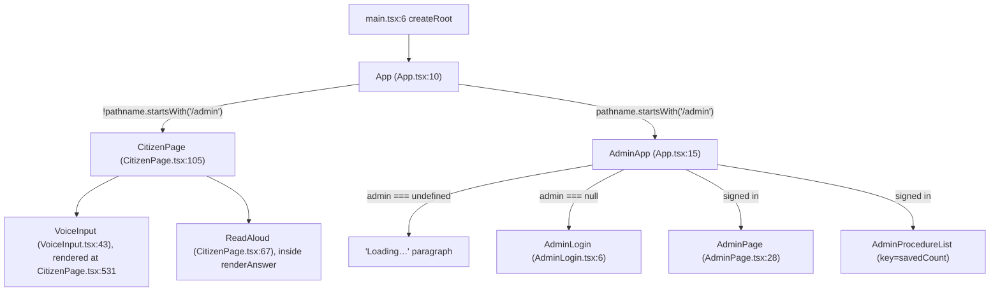
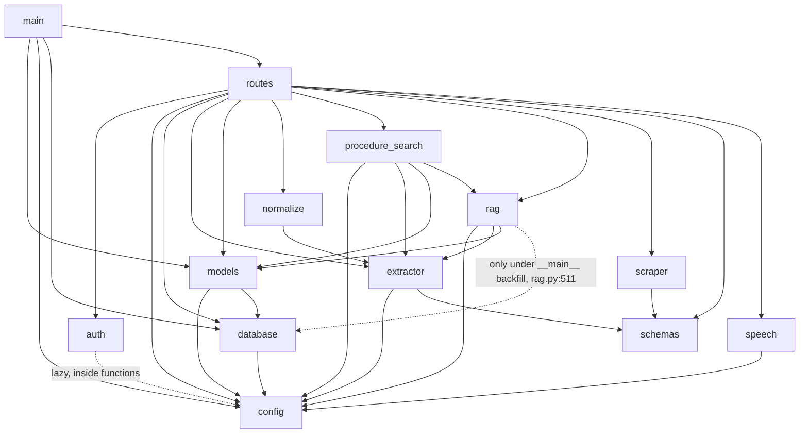

# 14 — Application Architecture and Execution Flow (Lesson 1.2)

Method: read-only inspection of the working tree at `/Users/arunnm/Projects/SOP` (branch `arun-nm`, with uncommitted changes). No code, tests, scripts, database or AI service was run. `.env` was never opened for values.

**Line numbers are for the files as they were when read for this report.** Several files changed on disk while this lesson series was running (`backend/rag.py` is now 514 lines, `backend/procedure_search.py` 258, `backend/routes.py` 421, `backend/schemas.py` 234, `frontend/src/api.ts` 206, `frontend/src/CitizenPage.tsx` changed `answerFollowUp`). Line numbers for those files in `13_REPOSITORY_CODEBASE_OVERVIEW.md` are therefore stale. If you edit files, re-grep before relying on any number here.

Labels: **[CONFIRMED]** read directly in source. **[INFERENCE]** my reasoning from confirmed facts. **[UNVERIFIED]** needs a run, a live service, or files I did not read.

---

## 1. Executive architecture overview

- **Shape** [CONFIRMED]: a browser SPA (React 19 + Vite) talking JSON over HTTP to one FastAPI process, which uses one PostgreSQL database (pgvector) and a local Ollama server. Optional local speech model runs inside the FastAPI process.
- **Frontend**: entry `frontend/index.html:10` → `frontend/src/main.tsx:6` → `App` (`frontend/src/App.tsx:10`). One bundle; `/admin*` shows the admin UI, any other path shows the citizen chat (`App.tsx:11`).
- **Backend**: entry `backend/main.py:13` (`app = FastAPI(...)`), started by `uvicorn backend.main:app` (`run.sh:52`). All routes live in `backend/routes.py`.
- **Database**: PostgreSQL via SQLAlchemy 2 + psycopg2 (`backend/database.py:10`); pgvector column `ProcedureChunk.embedding` (`backend/models.py`, `Vector(EMBEDDING_DIMENSIONS)`).
- **AI**: Ollama over HTTP: `/api/generate` for the LLM (`backend/extractor.py:46-80`) and `/api/embed` for embeddings (`backend/rag.py:116-133`). Default models `qwen3:8b` and `qwen3-embedding:0.6b` (`backend/config.py:23,26`).
- **Speech**: Indic-Transcribe Flex (Hugging Face model, local weights) loaded lazily in-process (`backend/speech.py:67-82`).
- **Scraping**: httpx + BeautifulSoup, with Playwright Chromium fallback (`backend/scraper.py:363-379`).
- **Run model** [CONFIRMED]: local-development only. `run.sh` launches uvicorn and the Vite dev server as two background processes. No Dockerfile, no CI file, no production static serving, no reverse proxy and no deployment manifest exists in the repository. Any production deployment story is **[UNVERIFIED]** (not in the repo).
- **Authentication**: one admin; stateless signed cookie `admin_session` (`backend/auth.py:55-74`). Citizens are anonymous.
- **Central design idea** [CONFIRMED from code and comments]: the LLM only proposes; deterministic code decides. Answers are shown only if their quotes are found verbatim in stored official text (`backend/rag.py:333-374`).

---

## 2. System architecture diagram

Only components with a code reference are drawn. Each edge label cites where the connection is made.

Supporting processes started by `start.sh`: PostgreSQL via `brew services` (`start.sh:16`), `ollama serve` if not running (`start.sh:18-22`). Neither is a Python/JS dependency of the app code itself.

---

## 3. Application startup sequence

Chronological. Nothing below was executed.

| # | Step | File:line | What happens |
|---|---|---|---|
| 1 | `./start.sh` (optional wrapper) | `start.sh:7-12` | `setting()` greps `.env` for `OLLAMA_BASE_URL`, `LLM_MODEL`, `EMBEDDING_MODEL` without sourcing it |
| 2 | Start PostgreSQL | `start.sh:16` | `brew services start postgresql@16`, errors ignored (`|| true`) |
| 3 | Ensure Ollama | `start.sh:18-22` | `curl $OLLAMA_URL/api/tags`; if down, `nohup ollama serve` and wait |
| 4 | Check models | `start.sh:24-29` | Exits if `LLM_MODEL` or `EMBEDDING_MODEL` is absent from `/api/tags` |
| 5 | Warm-up and open browser | `start.sh:32,34` | `ollama run $LLM_MODEL "hi"`; `open http://localhost:5173` after 6 s |
| 6 | Hand over | `start.sh:35` | `exec ./run.sh` |
| 7 | `run.sh` preflight | `run.sh:17-19` | Requires `.env`. Also requires `python3` and `npm` (`run.sh:12-13`) |
| 8 | Dependencies | `run.sh:27-30` | `pip install -r requirements.txt` and `playwright install chromium` **every run**; `npm install` only if `frontend/node_modules` is missing |
| 9 | DB probe | `run.sh:33-37` | Runs `python -c 'from backend.database import engine; engine.connect()'`. This imports `backend.config`, so **configuration is loaded and validated here first** |
| 10 | Backend process | `run.sh:52` | `python -m uvicorn backend.main:app --host 127.0.0.1 --port 8000 &` |
| 11 | Frontend process | `run.sh:53-57` | In `frontend/`: `vite --host 127.0.0.1 --port 5173 --strictPort &` |
| 12 | Supervision | `run.sh:44-50` | `trap cleanup EXIT HUP INT TERM` kills both children; loop exits when either dies |

**Inside the backend import (step 10), in order** [CONFIRMED from import statements]:
1. `backend/main.py:1-7` imports FastAPI, `models`, `config`, `database`, `routes`.
2. `backend/config.py:7` `load_dotenv(<repo>/.env)`. Then `_required_setting` raises `RuntimeError` if `DATABASE_URL` (`:21`), `SECRET_KEY` (`:30`) or `ADMIN_PASSWORD_HASH` (`:34`) is missing. `SECRET_KEY` shorter than 32 characters is rejected (`:31-32`), and the hash must start with `scrypt$` (`:35-36`).
3. `backend/database.py:10-12` creates `engine`, `SessionLocal`, `Base`. `create_engine` is lazy; it does not connect yet.
4. `backend/models.py` defines the two tables on `Base`.
5. `backend/routes.py` imports the rest (`auth`, `extractor`, `normalize`, `procedure_search` → `rag`, `scraper`, `speech`, `schemas`); it builds `router` and `admin_router` (`routes.py:71-72`).
6. `backend/main.py:10` `Base.metadata.create_all(bind=engine)` runs **at import time** and connects to the database. If the DB is down or the `vector` extension is missing, startup fails here.
7. `backend/main.py:13` creates `FastAPI(title="ProcedureAssist")`.
8. `backend/main.py:14-20` registers `CORSMiddleware`: `allow_origins=[FRONTEND_ORIGIN]`, `allow_credentials=True`, methods `GET/POST/DELETE`, header `Content-Type` only.
9. `backend/main.py:21` `app.include_router(router)`. `routes.py:421` has already done `router.include_router(admin_router)`.

**Startup/shutdown hooks:** none. `grep` for `on_event`, `lifespan`, `startup` and `shutdown` in `backend/` found none [CONFIRMED by absence in the files read]. No model is warmed inside the app; the speech model loads lazily on first use (`speech.py:67`).

**Frontend initialization:** the browser loads `frontend/index.html` (`
`, `src/main.tsx`, `src/styles.css`). `main.tsx:6-9` renders `<StrictMode><App/></StrictMode>` with `createRoot`. `App` (`App.tsx:10-12`) picks a page from `window.location.pathname`. For `/admin*`, `AdminApp` calls `getSession()` in a `useEffect` (`App.tsx:21-25`).

**Environment loading:**
- Backend: `.env` through `python-dotenv` (`config.py:7`). Real environment variables also work, because `os.getenv` is read afterwards and `load_dotenv` does not override existing variables by default [INFERENCE from python-dotenv defaults].
- Frontend: `import.meta.env.VITE_API_BASE_URL || "http://localhost:8000"` (`api.ts:3-4`); optional `frontend/.env` per `frontend/.env.example`.
- Shell: `start.sh` re-reads three keys itself, so those defaults (`start.sh` fallbacks) must stay in step with `config.py` defaults. They match today (`qwen3:8b`, `qwen3-embedding:0.6b`, `http://localhost:11434`).

---

## 4. Frontend component architecture

**Hierarchy** [CONFIRMED]:

**Navigation:** there is no router. A full page load at `/` vs `/admin` selects the tree (`App.tsx:11`). There are no links between the two UIs [CONFIRMED by reading all files]. The Vite dev server serves `index.html` for `/admin`; production fallback behaviour is **[UNVERIFIED]** (no production serving exists in the repo).

**State management:** React local state only (`useState`, `useRef`, `useEffect`); no context, reducer, store or data-fetching library.
- `CitizenPage` (`:106-114`): `situation`, `language`, `matches` (last `IdentifyResponse`), `procedure` (open `ProcedureDetail`), `messages` (the conversation), `pending` (`identify|procedure|guidance|null`), `error` ({text, retry}), `lastId`/`latest` refs. Updates to messages are keyed by id (`update` `:122`), so a reply to a message that was reset is dropped.
- `AdminApp` (`App.tsx:17-19`): `admin` (`undefined` = checking, `null` = signed out), `notice`, `savedCount` (used as `key` to remount `AdminProcedureList` after a save, `App.tsx:61`).
- `AdminPage` (`:28+`): URL, source text, provenance token, draft, step list with stable ids, drag state.
- `VoiceInput` (`:44-49`): `state`, `seconds`, `error`, refs for the recorder, cancel flag, timer.

**Where API requests originate** (all via `api.ts`):

| Caller | Functions called |
|---|---|
| `App.tsx` `AdminApp` | `getSession` (`:22`), `logout` (`:35`) |
| `AdminLogin.tsx:23` | `login` |
| `AdminPage.tsx` | `extractProcedure` (`:103`), `reExtractProcedure` (`handleReExtract` `:119`), `approveProcedure` (`:182`) |
| `AdminProcedureList.tsx` | `listSavedProcedures`, `deleteProcedure` |
| `CitizenPage.tsx` | `identifyProcedure` (`:164`, `:217`, `:262`), `getProcedure` (`:153`, `:236`), `askGuidance` (`:150`, `:175`), `askRelation` (`:184`, `:228`) |
| `VoiceInput.tsx:90` | `transcribeSpeech` |

**Response and error handling:**
- `request<T>` (`api.ts:62-82`): on non-2xx it throws `Error(detail || fallback)` where `detail` is the JSON `detail` string if present (`errorMessage` `:55-60`). A 204 returns `undefined` (`:81`).
- Citizen errors: `run()` (`CitizenPage.tsx:134-144`) catches, stores `{text, retry}`; the "Try again" button re-runs the same action. Multi-need sections keep their own `error` (`answerSection` `:172-179`) so one failing need does not clear others.
- Admin errors: each handler keeps an `error` string and renders `
`.
- Voice errors: `VoiceInput` shows its own `error` (`:93-94`, `:133`).

**Authentication on the client:** the browser never sees or stores the token in JS. The server sets an `httponly` cookie; `fetch` sends it because every call uses `credentials: "include"` (`api.ts:70`). There is no `Authorization` header anywhere in `api.ts`. Session state in the UI is just `admin` (username string). A 401 on any path other than login/session dispatches `UNAUTHORIZED_EVENT` (`api.ts:75-77`), which `AdminApp` listens for (`App.tsx:26-31`) to drop to the login screen with a notice.

**Voice → backend:** `CitizenPage` renders `<VoiceInput language={language} disabled={busy} onTranscript=... />` (`:531-532`). `onTranscript` appends the text to the question box; it does not submit. See §12.

---

## 5. Backend module dependency architecture

Built from every `from backend...` / `import backend` line (grep over `backend/*.py`).

**Circular imports:** none found in this graph. The only back-edge candidates are lazy: `auth → config` (function-level imports `auth.py:23,48,62`) and `rag → database` (inside the `__main__` block, `rag.py:511`).

**Application assembly:** `main.py` composes; it has no business logic.
**Router organization:** two routers in one file. `router` (public) and `admin_router = APIRouter(dependencies=[Depends(require_admin)])` (`routes.py:71-72`), merged at `routes.py:421`. Protected by `admin_router`: extract, re-extract, POST/GET/DELETE procedures. Not protected: health, login, logout, `/api/procedures*`, speech, identify, guidance, relation. `/api/admin/session` is on `router` but declares `Depends(require_admin)` itself (`routes.py:124-125`).

**Dependency injection** [CONFIRMED]: FastAPI `Depends` is used for DB sessions (`get_db`, `get_read_only_db`) and auth (`require_admin`). Business modules (`rag`, `procedure_search`) receive the `Session` as an argument rather than creating one, except the `backfill` CLI.

**Request validation:** Pydantic models with `extra="forbid"` (`schemas.py:43`) for bodies; URL checks (`_http_url`), size limits (`schemas.py:7-10`), question length 1000, `Language = Literal["en","ta"]` (`:12`). Unknown language → FastAPI 422 (covered by `tests/test_normalize.py`, not re-run). Path ints validated by FastAPI.

**Response serialization:** `response_model=` on all JSON routes. `identify`, `guidance` use `response_model_exclude_unset=True` (`routes.py:322,363`) and `relation` uses `response_model_exclude_defaults=True` (`:398`), so optional fields appear only when the handler set them (`normalized_query`, `named`, `partial`, `clarification`). This is why `schemas.IdentifyResponse.named` defaults to `False` (`schemas.py` near `:162`) but is only sent when `True` (`routes.py:346`).

**Business-logic boundaries:**
- `routes.py` = HTTP translation, error mapping, composition.
- `scraper.py` = fetching/cleaning only; knows nothing of the DB or LLM.
- `extractor.py` = the only place that talks to the LLM endpoint (`call_qwen`, `:46`); also admin extraction.
- `rag.py` = embeddings + chunking + answering + verification; the only module that talks to the embedding endpoint (`embed_texts`, `:116`).
- `procedure_search.py` = which procedure a question is about; uses `rag.embed_texts` and `rag.uses_name`.
- `normalize.py` = Tamil → English query.
- `speech.py` = audio validation and model call.
- `auth.py` = credentials, cookie, provenance.

**Error handling pattern** [CONFIRMED]: each lower module raises its own exception (`ScraperError`/`SourceUnavailableError`, `ExtractionError`, `EmbeddingError`, `GuidanceError`, `AudioError`, `SpeechUnavailableError`, `SpeechBusyError`, `TranscriptionError`, `ProvenanceError`); `routes.py` maps them to HTTP status codes with fixed, citizen-safe messages (e.g. `routes.py:383-386`, `:305-318`). `normalize_query` and `extract_needs` deliberately swallow failures and return `None` (`normalize.py:55+`, `procedure_search.py:198+`), so those features degrade silently to the plain flow.

---

## 6. Frontend / backend API mapping

Base URL: `API_BASE_URL = import.meta.env.VITE_API_BASE_URL || "http://localhost:8000"` (`api.ts:3-4`). Every call goes through `request()` (`api.ts:62`).

| API function (`api.ts`) | Method | Endpoint | Request | Response | Backend handler (`routes.py`) |
|---|---|---|---|---|---|
| `extractProcedure` `:84` | POST | `/api/admin/extract` | `{source_url}` | `ExtractionResponse {source_text, procedure, provenance_token}` | `create_extraction` `:130` (admin) |
| `reExtractProcedure` `:91` | POST | `/api/admin/re-extract` | `{source_url, source_text, provenance_token}` | `ProcedureDraft` | `re_extract_procedure` `:158` (admin) |
| `approveProcedure` `:98` | POST | `/api/admin/procedures` | `{procedure, source_text, provenance_token}` | `{id, name, status}` | `save_procedure` `:169` (admin) |
| `login` `:105` | POST | `/api/admin/login` | `{username, password}` | `{username}` + `Set-Cookie` | `login` `:103` |
| `logout` `:111` | POST (explicit method arg) | `/api/admin/logout` | none | 204 | `logout` `:118` |
| `getSession` `:114` | GET | `/api/admin/session` | none (cookie) | `{username}` | `session` `:125` |
| `listSavedProcedures` `:117` | GET | `/api/admin/procedures` | none | `AdminProcedure[]` | `list_saved_procedures` `:223` (admin) |
| `deleteProcedure` `:120` | DELETE | `/api/admin/procedures/{id}` | none | 204 | `delete_procedure` `:237` (admin) |
| `identifyProcedure` `:178` | POST | `/api/identify` | `{question, language}` | `IdentifyResponse` | `identify_procedure` `:323` |
| `getProcedure` `:184` | GET | `/api/procedures/{id}` | none | `ProcedureDetail` | `get_procedure` `:270` |
| `askRelation` `:187` | POST | `/api/relation` | `{procedure_ids, question}` | `RelationResponse` | `relation` `:399` |
| `askGuidance` `:193` | POST | `/api/guidance` | `{procedure_id, question, language}` | `GuidanceResponse` | `guidance` `:364` |
| `transcribeSpeech` `:201` | POST | `/api/speech/transcribe?language=` | raw WAV `Blob` | `{text, language}` | `transcribe_speech` `:295` |

**Backend endpoints with no frontend caller** [CONFIRMED by comparing `api.ts` to `routes.py`]: `GET /health` (`routes.py:76`), `GET /health/ready` (`:81`), `GET /api/procedures` (list, `:261`). Used by `start.sh`/humans/tests, not by the SPA.
**Frontend functions with no matching endpoint:** none. All 13 functions map to a registered route.

**Verification points:**
- **Headers:** only `Content-Type`, and only when a body is sent: `application/json`, or the Blob's own type (`api.ts:71`). No custom or `Authorization` headers. CORS allows only `Content-Type` (`main.py:19`), consistent.
- **JSON:** `JSON.stringify(body)` (`api.ts:72`); non-Blob bodies only.
- **Multipart/form-data:** not used anywhere [CONFIRMED]. Audio is the raw request body with `Content-Type: audio/wav`.
- **CORS:** one origin (`FRONTEND_ORIGIN`, default `http://localhost:5173`) with credentials; methods GET/POST/DELETE. A `PUT`/`PATCH` would be blocked, but none exist.
- **Cookie flags:** `httponly`, `samesite="strict"`, `secure=COOKIE_SECURE` (`routes.py:106-113`). `localhost:5173` → `localhost:8000` is same-site (ports do not matter for "site"), so strict cookies are sent [INFERENCE]. Using `127.0.0.1:5173` would fail CORS (README says so).
- **HTTP status handling in client:** any non-OK throws; 401 additionally fires the logout event unless the path is login/session (`api.ts:53,75`). No retry, no timeout, no `AbortController` in `request()` [CONFIRMED]. A hung backend leaves the UI in its "pending" state until the browser gives up.
- **Backend statuses actually used:** 401 (auth), 404 (unknown procedure), 409 (duplicate URL), 413/415 (audio size/type), 422 (scraper/provenance/validation/audio), 500 (save/delete DB failure), 502 (LLM/embedding/scrape upstream), 503 (speech not installed/busy; readiness), 504 (transcription timeout).

---

## 7. Database architecture

**Schema definition (code)** [CONFIRMED]:
- `backend/database.py:10` `engine = create_engine(DATABASE_URL)` (default pool, driver from the URL; `psycopg2-binary` pinned in `requirements.txt`). `:11` `SessionLocal = sessionmaker(autocommit=False, autoflush=False, bind=engine)`. `:12` `Base = declarative_base()`.
- `backend/models.py:9-19` `Procedure` → table `procedures`: `id` PK, `name`, `department?`, `jurisdiction?`, `summary`, `source_url` (NOT NULL, **UNIQUE**), `source_text`, `structured_data` JSONB NOT NULL.
- `backend/models.py:22-37` `ProcedureChunk` → `procedure_chunks`: `id` PK, `procedure_id` FK → `procedures.id` `ON DELETE CASCADE` (indexed), `chunk_index`, `content`, `embedding Vector(EMBEDDING_DIMENSIONS)` NOT NULL, `UniqueConstraint(procedure_id, chunk_index)`.
- No ORM `relationship()` objects; joins are done by explicit `procedure_id` queries.
- No vector index (HNSW/IVFFlat) declared in the models. The `vector` extension is not created by the app (`create_all` only creates tables); `tests/db_support.py:49` creates it for the test DB only.
- No migration tool; schema creation is `Base.metadata.create_all` (`main.py:10`), which never alters existing tables.

**Session lifecycle and how sessions reach handlers:**
- `get_db` (`database.py:15-20`): creates a `SessionLocal()`, `yield`s it, closes in `finally`. Used by admin routes and `/health/ready`.
- `get_read_only_db` (`database.py:23-26`): `Depends(get_db)` then `SET TRANSACTION READ ONLY` (`:25`). Used by `/api/procedures*`, `/api/identify`, `/api/guidance`, `/api/relation` (`routes.py:262,271,324,365,400`). PostgreSQL rejects writes on those requests.
- Transactions: admin writes commit explicitly (`routes.py:202`, delete `:243-248`), with `rollback()` on `SQLAlchemyError` and `IntegrityError` (`:203-217`). Pgcode `23505` becomes 409 (`:205-209`).
- Embeddings are computed before touching the DB (`routes.py:177`; docstring `rag.py:137`): an embedding failure leaves nothing saved (502).
- `procedure_search` and `rag` receive `db` from the route and never commit. The only non-route session is `rag.py:511` (`backfill` CLI).

**Vector search** [CONFIRMED]: both use `ProcedureChunk.embedding.cosine_distance(vector)`. `procedure_search.rank_procedures` (`:74-85`) groups by procedure with `max(1 - distance)`; `rag.retrieve` (`:161-172`) orders chunks within one procedure.

**Live database state: [UNVERIFIED].** I did not connect. Existing evidence files under `PROCEDUREASSIST_HANDOFF/evidence/database/` (e.g. `schema.txt`) exist but I did not read them in this lesson. The handoff docs mention two databases (main and a staging copy) — **not confirmed from source**; the code only knows one `DATABASE_URL`.

---

## 8. AI and external integration architecture

| Integration | Implementing file / function | Input | Expected output | Config | Failure handling | Consumers |
|---|---|---|---|---|---|---|
| **Ollama LLM (Qwen3)** | `extractor.call_qwen` `extractor.py:46-80` | prompt string | model JSON text (`format:"json"`, `think:false`, `temperature:0`, `num_ctx`) | `OLLAMA_BASE_URL`, `LLM_MODEL`, `LLM_CONTEXT_TOKENS` (`config.py`) ; 60 s timeout (`QWEN_TIMEOUT_SECONDS`) | timeout/HTTP/connect/empty → `ExtractionError` (`:62-78`) | `extract_procedure`, `normalize_query`, `extract_needs`, `rag._ask` |
| **Procedure extraction** | `extractor.extract_procedure` `:91`, `build_extraction_prompt` `:17`, `parse_extraction` `:83` | scraped text + URL | validated `ProcedureDraft` | as above | invalid shape → `ExtractionError("…invalid structured data")` → route 502 | `create_extraction`, `re_extract_procedure` |
| **Query normalization (LLM)** | `normalize.normalize_query` `normalize.py:55` | citizen question | `{normalized_query, needs_clarification, clarification_reason}` or `None` | same LLM | any failure → `None` (original question searched) | `routes._normalized` `:288` |
| **Need splitting (LLM)** | `procedure_search.extract_needs` `:198` | message | needs + relation question, or `None` | same LLM | untrusted output → `None` (single flow) | `identify_needs` |
| **Answer generation + check (LLM)** | `rag._answer` `:448`, `check_claims` `:472`, `_ask` `:462` | prompt with passages | claims JSON; correctness JSON | same LLM | `GuidanceError` → route 502 | `answer_question`, `relate`, `compare`, `answer_from_naming_pages` |
| **Embeddings** | `rag.embed_texts` `rag.py:116-133` | list of texts; queries get `QUERY_INSTRUCTION` prefix | list of 1024-d vectors | `EMBEDDING_MODEL`, `EMBEDDING_DIMENSIONS`; 60 s timeout | HTTP error, bad JSON, wrong count or dimension → `EmbeddingError` | `build_chunks` (save), `retrieve`, `identify`, `identify_needs` |
| **PostgreSQL + pgvector** | `database.py`, `models.py` | — | — | `DATABASE_URL` | route-level rollback and 409/500 | all |
| **Ollama health** | `routes.readiness` `routes.py:82-99` | GET `/api/tags` (3 s) | both models listed | same | sets `ollama: unavailable / models missing` → 503 | operators |
| **Indic-Transcribe Flex** | `speech.transcribe` `speech.py:85`, `_load` `:67-82`, `check_audio` `:48` | 16 kHz mono 16-bit WAV bytes + `"ta"|"en"` | text (≤1000 chars) | `SPEECH_MODEL`, `SPEECH_MODEL_DIR` | missing package/weights → `SpeechUnavailableError`; lock timeout 30 s → `SpeechBusyError`; other → `TranscriptionError` | `routes.transcribe_speech` |
| **Web fetch** | `scraper.fetch_static_html` `:173`, `fetch_rendered_html` `:303` | admin URL | HTML | constants in `scraper.py` | `ScraperError` (client) / `SourceUnavailableError` (upstream) | `create_extraction` |
| **Playwright Chromium** | `fetch_rendered_html` `:309-310` | URL (headless) | rendered HTML | needs `playwright install chromium` (`run.sh:28`) | Playwright errors → `SourceUnavailableError` (`:351-354`) | `scrape_url` fallback |

Isolation observations [CONFIRMED]: all LLM traffic funnels through one function (`call_qwen`), all embedding traffic through one function (`embed_texts`), and speech through one module. The model name is never hard-coded outside `config.py` defaults, other than `speech.py`'s mode map (`MODES = {"ta":"mixed","en":"native"}`, `:25`).
Indic-Transcribe specifics are **[UNVERIFIED]**: the code imports `indic_transcribe.IndicTranscribe` from the downloaded model directory (`speech.py:75-79`) and calls `model(path, lang=..., mode=...)` (`:96`). I did not see that package, and no model was loaded.
No other external service (SaaS or cloud API) is referenced in `backend/` or `frontend/src/`.

---

## 9. Citizen text-query execution trace (Workflow A)

Entry: user types in the composer and presses Send / Enter.

**Frontend**
1. `CitizenPage.sendOnEnter` → `form.requestSubmit()` (`CitizenPage.tsx:330`), `<form onSubmit={handleSend}>` (`:512`).
2. `handleSend` (`:248`): trims, creates a `Message` (`newMessage` `:120`). If a procedure is open or more than one is matched → follow-up path; else new-question path.
3. New question: `run("identify", () => handleResult(await identifyProcedure(question, language), message))` (`:261-263`).
4. `api.identifyProcedure` (`api.ts:178`) → `request` (`:62`) → `POST {API_BASE_URL}/api/identify`, `{question, language}`, `credentials: "include"`.

**Backend `/api/identify`** (`routes.py:322-360`)
5. FastAPI validates `IdentifyRequest` (`schemas.py:131`, question ≤ 1000, trimmed non-empty). `db = get_read_only_db` (read-only transaction).
6. `_normalized(question, language)` (`:327`, `:288`): `normalize.needs_normalizing` (Tamil selected, Tamil script, or Romanized-Tamil regex) → if true `normalize.normalize_query` → LLM `call_qwen`. If it says clarification is needed → `IdentifyResponse(status="no_match", clarification=CLARIFY)` (`:328-329`). Else the English query replaces the question and `normalized_query` is echoed (`:330-331`).
7. `names_something(question)` (`:332`): if only generic words → `no_match` + `CLARIFY`.
8. `identify_needs(db, question)` (`:335`, `procedure_search.py:220`): if `MULTI_HINT` matches → `extract_needs` (LLM); `COMPARED` regex handles "difference between A and B". Returns a tuple for multi-need, a `[phrase, question]` list for one need, or `None`.
9. Single flow: `identify(db, question, need=multiple)` (`:337`, `procedure_search.py:169`) → `rag.embed_texts(texts, query=True)` (Ollama `/api/embed`) → per text `_decide` (`:140`): `rank_procedures` (pgvector, top 3) → `classify` (score ≥ 0.53 and within 0.03 of best) → acronym rules (`abbreviates`, `ACRONYM`) → `mentions` → `named_by_the_others` (`:164`). Result `matched | ambiguous | no_match`.
10. Response: `IdentifyResponse(status, candidates=[ProcedureSummary…], named=True only if matched and names_procedure(...))` (`routes.py:343-348`). `EmbeddingError` → HTTP 502 (`:338-341`).
11. Multi-need: `status="multiple"` with `needs`, `pending`, `relation_question` (`:349-360`).

**Frontend again**
12. `handleResult` (`:206`): `setMatches`; `searchedAs` stores `normalized_query` for the "Searched as" line (`:127-131`).
13. `matched` → `showAndAnswer(candidates[0].id)` (`:209`, `:235`): `getProcedure` → `GET /api/procedures/{id}` (`routes.py:270`, read-only DB) → `setProcedure`, then `answer(id, message)` (`:147`).
14. `answer` → `askGuidance(id, asked(message), message.query ? "en" : language)` (`:150`) → `POST /api/guidance`.

**Backend `/api/guidance`** (`routes.py:363-395`)
15. `db.get(Procedure, id)` → 404 if missing. Optional `_normalized` again (skipped by the client if a normalized query is already known, `:150`).
16. `rag.answer_question` (`rag.py:395`) → `_checked_answer` (`:500`) → `retrieve` (top 5 chunks by cosine distance within that procedure; embeds the question) → `_answer` (`:448`): `build_guidance_prompt` → `_ask` → `call_qwen` → `verify_claims` (`:333`, deterministic) → `check_claims` (`:472`, second LLM pass + `_for_the_asker`). For fee questions with no amount or "free" in the kept quotes, `complete` is forced false (`:505-506`).
17. If not `complete`: `answer_from_naming_pages` (`rag.py:377`) tries other approved pages whose text names this procedure, keeps only claims whose own row uses the procedure's name (`:388-391`), and the route appends them with that page's `procedure_id`/`source_url` (`routes.py:379-382`).
18. `GuidanceResponse(insufficient_evidence = not claims, claims, omitted_claims, normalized_query?, partial? )` (`:387-395`). `GuidanceError`/`EmbeddingError` → 502 (`:383-386`).

**Frontend rendering**
19. `answer` fetches names for any related page ids via `getProcedure` (`:151-154`), stores `{answer, sources}` on the message (`:155`).
20. `renderAnswer` (`:266`): refusal text if `insufficient_evidence`; else an ordered list of claims, each with `
` "Official source" (quote + link), a partial-answer note, an omitted-claims note, `ReadAloud`, and a link to the official page.
21. `ambiguous` → "Which of these fits your situation?" list; `openProcedure` (`:242`) opens the choice. `no_match` → message with `matches.clarification` or the default text.

**Follow-up path** (`handleSend` `:255-259`, `answerFollowUp` `:163-169`) [CONFIRMED, current code]: for an open procedure the client **first calls `identifyProcedure`** (`:164`), then: if the result is a different procedure and `result.named` is true → answer from that procedure (`:166`); else answer from the open one (`:167`), and if it has insufficient evidence and a different procedure matched, answer from that one (`:168`). With several matched procedures (`followUp` `:216`): answer from the one named, or call `askRelation` when `ASKS_RELATION` matches, else show a "which procedure?" note.

**Database interactions:** read-only queries in steps 9, 13, 16, 17. No writes.
**External interactions:** Ollama `/api/generate` (0-4 calls per question depending on path; see risks), `/api/embed`.
**Failure paths:** 502 messages from steps 10, 18; `run()` catches and renders a retry (`:139-141`); `normalize_query`/`extract_needs` failures silently fall back; a blank question is not sent (`:251`).

Per-request call counts are **[INFERENCE]** from the code paths; actual latency is **[UNVERIFIED]**.

---

## 10. Admin authentication execution trace (Workflow B)

1. Page load at `/admin`: `App` → `AdminApp` (`App.tsx:15`). `useEffect` → `getSession()` (`:22`) → `GET /api/admin/session` with the cookie, if any.
2. Backend `session` (`routes.py:124-126`) depends on `require_admin` (`auth.py:60-74`): reads cookie `admin_session`; splits `session:<expiry>:<username>:<signature>`; requires `hmac.compare_digest(sign(payload), signature)`, `int(expiry) > time.time()`, and `username == ADMIN_USERNAME`; else `HTTPException(401)`.
3. 401 → the promise rejects → `setAdmin(null)` (`App.tsx:24`) → `AdminLogin` rendered (`:41-50`). (The client treats **any** failure, including a down backend, as "signed out".)
4. User submits → `AdminLogin.handleSubmit` (`AdminLogin.tsx:18`) → `login(username, password)` → `POST /api/admin/login`.
5. `routes.login` (`:103-114`): `check_admin_credentials` (`auth.py:47`) → `verify_password` (`:34`, scrypt, `hmac.compare_digest`) and constant-time username comparison on UTF-8 bytes. Wrong → 401 "Invalid username or password." (same message for either field).
6. Success: `create_session_token` (`auth.py:55-57`) = `session:<now+12h>:<username>:<HMAC-SHA256(SECRET_KEY)>`; `set_cookie(admin_session, ..., max_age=43200, httponly, samesite="strict", secure=COOKIE_SECURE)` (`routes.py:106-113`). Body `{username}`.
7. Client: `onSignedIn(username)` → `setAdmin(username)` (`App.tsx:45-48`) → renders `AdminPage` + `AdminProcedureList`.
8. Protected access: every `admin_router` route runs `require_admin` before the handler (`routes.py:72`). The browser attaches the cookie automatically (`credentials: "include"`, `api.ts:70`).
9. Expiry: a later 401 → `request()` dispatches `UNAUTHORIZED_EVENT` (`api.ts:75-77`) → `expire()` (`App.tsx:26-29`) → login screen with "Your session has expired…".
10. Logout: `handleSignOut` (`App.tsx:34-38`) → `POST /api/admin/logout` → `delete_cookie` (`routes.py:117-121`). The token is stateless, so it is not revoked server-side [CONFIRMED by reading `auth.py`: no store].

**Database interactions:** none. Admin identity is `ADMIN_USERNAME` + `ADMIN_PASSWORD_HASH` from configuration (`config.py:33-37`).
**Failure paths:** 401 invalid credentials; 401 invalid/expired cookie; `config.py` startup failure if hash format is wrong. No rate limiting or lockout exists in `routes.login`/`auth.py` [CONFIRMED by absence].
**Generating the hash:** `python -m backend.auth` (`auth.py` `__main__`).
**Edge [UNVERIFIED]:** `hmac.compare_digest(sign(payload), signature)` receives a `str` from the cookie; `compare_digest` raises `TypeError` for non-ASCII `str`. `check_admin_credentials` has a comment about this for usernames but `require_admin` has no equivalent guard. Whether a non-ASCII cookie reaches this line, and whether a test covers it, I did not verify.

---

## 11. Government ingestion execution trace (Workflow C)

1. `AdminPage` form (`<form onSubmit={handleExtract}>`): `handleExtract` (`AdminPage.tsx:96`) → `extractProcedure(sourceUrl)` (`:103`) → `POST /api/admin/extract` `{source_url}`.
2. FastAPI validates `ExtractRequest` (`schemas.py:55`, `_http_url`: http/https with a hostname, ≤ 2048 chars). `require_admin` runs first.
3. `routes.create_extraction` (`:130-147`) → `scraper.scrape_url(url)` (`scraper.py:363`):
   - `fetch_static_html` (`:173`): `validate_url` (`:111`: scheme, no credentials, no localhost, resolves DNS and rejects any non-global address), manual redirect loop up to 10 hops with `validate_url` on each (`:184-200`), `_get_with_retry` once on connection reset (`:154`), 2 MB cap (`_read_limited` `:162`), HTML content-type only.
   - `clean_html` (`:233`) → text blocks; `is_source_text_usable` (`:288`: ≥ 200 chars and ≥ 20 words, not a "loading/enable javascript" placeholder).
   - If unusable: `fetch_rendered_html` (`:303`) with Playwright Chromium; every sub-request is validated and aborted if non-public (`page.route`, `:317-324`); `clean_html` again.
   - `_result` (`:357`): rejects > 100,000 chars; `normalize_url` strips fragment, trailing slash, `utm_*`.
4. `extractor.extract_procedure(source_text, source_url)` (`extractor.py:91`): re-validates through `ScrapeResult`, `build_extraction_prompt` (source wrapped as untrusted data), `call_qwen` → `parse_extraction` → `ProcedureDraft` (`schemas.py:85`).
5. `issue_provenance_token(url, text)` (`auth.py:81`) = `provenance:<now+2h>:<sha256(url\ntext)>:<HMAC>`. Response `ExtractionResponse` (`routes.py:141-147`).
6. Client stores draft, steps (`toStepItems`), source text, token (`AdminPage.tsx:104-107`) and renders the review form. Source URL and source text are read-only fields in the form.
7. Review: the admin edits name/department/jurisdiction/summary/eligibility and reorders/edits/removes/adds steps. **Re-extract** (`handleReExtract` `:119`) → `POST /api/admin/re-extract` → `_verify_provenance` (`routes.py:150-154`, 422 on mismatch/expiry) → `extract_procedure` again on the same text. **Discard** (`:141`) clears local state.
8. Approve: `handleApprove` (`:153`) trims, requires name, summary and at least one step (client-side), calls `approveProcedure({procedure, source_text, provenance_token})` (`:182`) → `POST /api/admin/procedures`.
9. `routes.save_procedure` (`:169-219`):
   - validates `ApprovalRequest` (`schemas.py:101`) and `_verify_provenance(token, procedure.source_url, source_text)`.
   - `build_chunks(source_text)` (`rag.py:136`): `chunk_text` (`:81`, 1000-char chunks, 200 overlap) + `embed_texts` (Ollama) **before any DB write**; `EmbeddingError` → 502 "Nothing was saved." (`routes.py:177-182`).
   - `Procedure(...)` with `structured_data={eligibility, steps}`; `db.add`, `db.flush()`, set `chunk.procedure_id`, `db.add_all`, `db.commit()` (`:183-202`).
   - `IntegrityError` pgcode 23505 → 409 duplicate `source_url`; other DB errors → rollback + 500.
10. Response `{id, name, status:"saved"}`; `AdminPage` shows "Saved … with ID …" and calls `onSaved` (`:182-190`), which bumps `savedCount` and remounts `AdminProcedureList` (`App.tsx:60-61`).
11. List/delete: `listSavedProcedures` → `list_saved_procedures` (`routes.py:223`); `deleteProcedure` → `delete_procedure` (`:237`), chunks removed by `ON DELETE CASCADE`.

**Important structural fact** [CONFIRMED]: chunks are built from `request.source_text` (the scraped text), not from the admin-edited fields; edited fields go to `structured_data` and the columns. So admin edits never change what answers are generated from. Also, "approval" is not a stored status: a row is live for citizens as soon as it is committed.
**Batch alternative:** `scripts/approve_batch.py` repeats steps 1-9 through the same HTTP endpoints, with an interactive `y/N`.
**Failure paths:** 422 (invalid URL, blocked/private address, unreadable page, expired/mismatched token), 502 (upstream site error, Ollama down, invalid model output, embedding failure), 409 (duplicate), 500 (DB), 401 (session). Client shows `detail` text (`AdminPage` error state).
**Not enforced:** nothing checks that the URL belongs to a government domain (`auth.py` docstring at `verify_provenance_token` says so explicitly).

---

## 12. Complete voice-query execution trace (Workflow D)

1. **Mic interaction:** user clicks the mic button (`VoiceInput.tsx:125`) → `start()` (`:69`) sets state `starting`, calls `navigator.mediaDevices.getUserMedia({audio:true})` (`:74`). Denial/not found → mapped message (`MIC_ERRORS`, `:76`). If the browser lacks `getUserMedia`/`MediaRecorder` the component shows a text note instead (`:65-67`).
2. **Recording:** `new MediaRecorder(stream)` (`:81`), `ondataavailable` collects chunks, `rec.start()` (`:101`); a 250 ms interval updates the counter and calls `stop(false)` at `MAX_SECONDS` = 30 (`:105-109`). Cancel sets `cancelled` and discards (`:51-54`, `:87`).
3. **Frontend audio processing:** `rec.onstop` (`:83`) → `toWav(new Blob(chunks, {type: rec.mimeType}))` (`:90`, `toWav` `:11`): `OfflineAudioContext(1,1,16000).decodeAudioData` resamples, mixes channels to mono, and writes a 44-byte WAV header plus 16-bit PCM, returning `Blob(type:"audio/wav")`. A decode failure shows "The recording could not be read" (`:93-94`).
4. **API upload:** `transcribeSpeech(wav, language)` (`api.ts:201`) → `POST /api/speech/transcribe?language=ta|en`, body = raw blob, `Content-Type: audio/wav` (`api.ts:71`). No multipart.
5. **Backend endpoint:** `transcribe_speech` (`routes.py:295`, `async`): content-type must be in `WAV_TYPES` else 415 (`:298-299`); body streamed with a cap `MAX_AUDIO_BYTES` else 413 (`:300-304`).
6. `asyncio.wait_for(run_in_threadpool(transcribe, bytes(data), language), TIMEOUT_SECONDS)` (`:308`, 120 s). The blocking model call therefore runs off the event loop.
7. `speech.transcribe` (`speech.py:85`): `check_audio` (`:48`) enforces 16 kHz mono 16-bit WAV, 0.3-30 s, not near-silent (peak ≥ 200) → `AudioError`. Takes `_lock` with 30 s wait (`:88`) else `SpeechBusyError`. `_load()` (`:67`) lazily loads the model once (`snapshot_download(local_files_only=True)` or `SPEECH_MODEL_DIR`, adds the dir to `sys.path`, imports `indic_transcribe.IndicTranscribe`, `from_pretrained`) else `SpeechUnavailableError`. Writes a temp WAV (`:93`), calls `model(path, lang=language, mode=MODES[language])` (`:96`), deletes the file in `finally` (`:102-107`). Empty result → `AudioError`; output capped at 1000 chars.
8. **Error mapping** (`routes.py:309-318`): timeout 504, `AudioError` 422, `SpeechUnavailableError` 503, `SpeechBusyError` 503, `TranscriptionError` 502. Response `TranscriptionResponse{text, language}`.
9. **Back in the browser:** `onTranscript(text)` (`VoiceInput.tsx:91`) → `CitizenPage` appends it to the question box (`CitizenPage.tsx:532`). **Nothing is submitted automatically** [CONFIRMED].
10. **Query processing:** the citizen edits and presses Send → the same path as §9 from step 1, with `language` from the selector (`CitizenPage.tsx:527`). For Tamil/Tanglish, `normalize_query` rewrites it to English (§9 step 6) before search; answers are in English.
11. **RAG integration:** identical to §9 steps 9-18. There is no separate voice-specific RAG path.

**Database interactions:** none in steps 1-9. **External services:** the local speech model only (steps 7); LLM/embeddings only after Send.
**Privacy as coded:** audio is held in memory and in a temp file only during transcription; the route and `speech.py` do not log or persist it (no logging calls in either path as read). The transcript is not stored by these functions.
**UNVERIFIED stages:** step 7 (model package presence, signature of `IndicTranscribe`, `from_pretrained`, call arguments, runtime behaviour, memory use); the actual `MediaRecorder`/`OfflineAudioContext` behaviour in each browser (tests stub them, `VoiceInput.test.tsx:35-36`).
**Parameter note:** the endpoint's default `language="ta"` (`routes.py:295`) differs from the client, which always sends the selected language, so the default is never used by the SPA [INFERENCE].

---

## 13. Architectural decisions

### Explicitly documented in code comments or docstrings
- **Provenance vs authority:** `verify_provenance_token` docstring (`auth.py:87+`): proves the server recently extracted exactly this text from this URL, not that the URL is authoritative.
- **Read-only citizen routes enforced by PostgreSQL:** `get_read_only_db` docstring (`database.py:24`).
- **Embed before writing:** `build_chunks` docstring "Call outside any database transaction" (`rag.py:137`).
- **Settings imported lazily in `auth`** so `python -m backend.auth` can hash a password before `.env` exists (comment in `auth.py` above `sign`).
- **Local-only speech:** `speech.py` module docstring: audio never leaves the machine and is never stored.
- **Quote-verification philosophy:** `verify_claims` docstring (`rag.py:334-336`) and `CHECK_PROMPT`.
- **Thresholds from evaluation:** comment above `IDENTIFY_MIN_SCORE` (`config.py:38-39`).
- **Heuristics flagged by the authors** with `ponytail:` comments (`normalize.py` `ROMANIZED_TAMIL`, `procedure_search.py` `MULTI_HINT`, `mentions`, `rag.GENERIC_NAME_WORDS`).
- **Mirrored regex:** `CitizenPage.tsx:43` "Mirrors backend rag.COMPARISON".
- **Test isolation:** `tests/db_support.py` docstring.

### My interpretation (not stated in the repo)
- One `routes.py` and one `rag.py` keep the request path greppable at the cost of large files [INFERENCE].
- A single `api.ts` wrapper centralizes credentials, error mapping and the 401 event, so components stay free of fetch details [INFERENCE from usage: no component calls `fetch`].
- `admin_router` with a router-level dependency makes "forgotten auth on an admin route" harder than per-route decorators [INFERENCE]. `tests/test_auth.py` has `test_every_admin_route_requires_a_session` (name only; not run).
- Stateless signed cookies avoid a session table and a DB dependency for auth, at the cost of no revocation [INFERENCE, supported by `auth.py` and README limitations].
- LLM output is always treated as untrusted and re-checked in code before reaching the citizen [INFERENCE strongly supported by `verify_claims`, `extract_needs`, `normalize_query` validation].
- Sync `def` route handlers (FastAPI runs them in a threadpool) are used for blocking I/O; only the speech endpoint is `async`, because it streams the request body [INFERENCE].

---

## 14. Identified risks and inconsistencies

Evidence-based; none is a recommendation to redesign.

1. **Import-time side effects.** `backend/main.py:10` runs `create_all` on import; `config.py` raises on import. Any tool that imports `backend.main`, `backend.routes` or `backend.database` needs a reachable DB and a full `.env` (also why `tests/db_support.py` sets env vars first).
2. **`vector` extension not created by the app.** A fresh database fails at `main.py:10` until `CREATE EXTENSION vector` is run manually (README step 3). No migration mechanism for schema or embedding-dimension changes.
3. **Admin edits do not affect answers.** Chunks come from raw `source_text` (`routes.py:177`), not from reviewed fields (§11).
4. **No stored approval state.** Saved = live (`routes.py:183-202`); the "review" gate exists only in the UI flow, though the provenance token prevents saving text the server did not extract.
5. **No domain allow-list** for submitted URLs (any public http(s) URL). Acknowledged in `auth.py` docstring.
6. **Long, multi-call request paths with no client timeout.** `/api/guidance` can make two LLM calls (`_answer`, `check_claims`) plus two more via `answer_from_naming_pages` (`routes.py:379`), and since the current `answerFollowUp` adds an `/api/identify` call (which may add `extract_needs`/`normalize_query` LLM calls) the follow-up path can chain several. Each LLM call has a 60 s timeout (`extractor.py` `QWEN_TIMEOUT_SECONDS`); the browser `fetch` has none (`api.ts:68`). [Counts are INFERENCE; durations UNVERIFIED.]
7. **DB session held open during slow external calls.** Citizen routes keep one read-only transaction open (`get_read_only_db`) while Ollama is called (`routes.py:365-386`). Effect on connection-pool pressure under concurrent users is **[UNVERIFIED]** (default pool settings, `database.py:10`).
8. **Duplicated logic across the tier boundary:** `COMPARES` (`CitizenPage.tsx:44`) vs `COMPARISON` (`rag.py:45`); the client decides whether a relation answer is a comparison while the server decides separately (`routes.py:405`). They are meant to be identical; nothing enforces it.
9. **Overlapping helpers named alike:** `scraper.normalize_url`, `rag._normalize`, `procedure_search._norm`, and the module `normalize.py` all "normalize" different things (reading hazard, not a bug).
10. **Frontend treats every `getSession` failure as signed-out** (`App.tsx:22-25`), so a down backend shows the login screen, not an error.
11. **Config duplication in `start.sh`:** defaults for models/URL are repeated in shell (`start.sh:10-12`) and `config.py:22-26`. They agree today.
12. **Host/binding mix:** uvicorn and Vite bind `127.0.0.1` (`run.sh:52,56`) while the frontend default API URL and `FRONTEND_ORIGIN` default use `localhost` (`api.ts:4`, `config.py:29`). It works if `localhost` resolves to IPv4 or the browser falls back; behaviour on IPv6-first systems is **[UNVERIFIED]**.
13. **Reproducibility:** `run.sh:27-28` runs `pip install` and `playwright install chromium` on every start; no lockfiles (`npm install --package-lock=false`, `run.sh:30`).
14. **Auth hardening gaps** (also in README Limitations): no login rate limit, no server-side revocation, single admin, `compare_digest` on a `str` cookie (§10 edge, UNVERIFIED).
15. **Documentation drift.** The handoff docs describe two databases (main + staging) and test counts (e.g. "207 backend tests"); the source defines one `DATABASE_URL` and I counted a different number of `def test` functions earlier (209 before further edits). I did not re-verify either. Line numbers in `13_REPOSITORY_CODEBASE_OVERVIEW.md` are stale for files edited since.
16. **Unverified integration:** the Indic-Transcribe package interface (`speech.py:75-96`) cannot be confirmed from this repository.
17. **No dedicated tests for `database.py`/`models.py`.** They are covered indirectly by DB tests (names only, not run).

No circular imports were found (§5).

---

## 15. Unverified areas and missing evidence

- Whether the app starts, tests pass, or the frontend builds (nothing run).
- Live DB: tables, indexes, extension, data, number of databases.
- Ollama: model presence, response shapes, real latency.
- Indic-Transcribe: model files, `indic_transcribe` API, memory/time behaviour.
- Browser behaviour of `MediaRecorder`/`OfflineAudioContext` (tests use stubs).
- Production serving/deployment (no artifacts in the repo).
- `PROCEDUREASSIST_HANDOFF/01`-`12` and `evidence/` contents (not read in this lesson).
- Full bodies of: `backend/scraper.py` helper functions beyond the paths cited (`_row_context`, `clean_html` details), the prompt texts in `rag.py`/`normalize.py`/`procedure_search.py`, `rag.relate`/`compare` internals, `AdminPage` JSX, `styles.css`, all test case bodies, and `scripts/evaluate_*.py` bodies.
- `.env` values (intentionally not read).
- Whether the files changed on disk during this session (listed at the top) are intended; I treated their current content as authoritative.

---

## 16. Recommended next source files for detailed study

1. `backend/routes.py:322-395` — the two citizen entry points; keep open next to `frontend/src/CitizenPage.tsx:134-264`.
2. `backend/procedure_search.py` `_decide`, `identify`, `identify_needs` (`:140-258`) — the matching rules.
3. `backend/rag.py:333-374` (`verify_claims`) and `:472-507` (`check_claims`, `_checked_answer`) — the answer safety net; pair with `tests/test_guidance.py`.
4. `backend/scraper.py:111-152` (`validate_url`) and `:233-286` (`clean_html`) — SSRF safety and what text enters the system.
5. `backend/auth.py` (112 lines) — complete auth model.
6. `backend/models.py` + `PROCEDUREASSIST_HANDOFF/evidence/database/schema.txt` — compare code schema with the recorded live schema.
7. `backend/speech.py` + `frontend/src/VoiceInput.tsx` — the voice path end to end.
8. `tests/db_support.py` — how the whole backend is exercised without Ollama.
9. `PROCEDUREASSIST_HANDOFF/03_AI_AND_RAG_LOGIC.md` and `07_DATABASE_AND_SAFETY.md` — read after the source, as claims to check against it.

---

## Inspection record

**Inspected in full or in the cited ranges:** `start.sh`, `run.sh`, `.claude/launch.json`, `package.json`, `requirements*.txt`, `.env.example` (and `.env` key names only), `backend/{main,config,database,models,auth,routes,schemas,extractor,normalize,speech,scraper,procedure_search,rag}.py` (current versions; rag/procedure_search/routes re-read after they changed), `frontend/src/{main,App,api,AdminLogin,AdminPage,AdminProcedureList,CitizenPage,VoiceInput}.tsx/ts`, `frontend/vite.config.ts`, `frontend/index.html`. Git diff of the changed backend/frontend files was used to find what changed.

**Workflows not fully verifiable from source alone:**
- **D (voice)**: the model-loading and transcription stage (`speech.py:67-96`) depends on an external package and weights I did not see, and I did not run browser audio code.
- **A (citizen query)**, **C (ingestion)**: all code paths are traced, but outcomes depend on live Ollama/DB/web behaviour that I did not exercise (quality, latency, real page content).
- **B (authentication)**: fully traced in code; only the non-ASCII-cookie edge is unverified.
